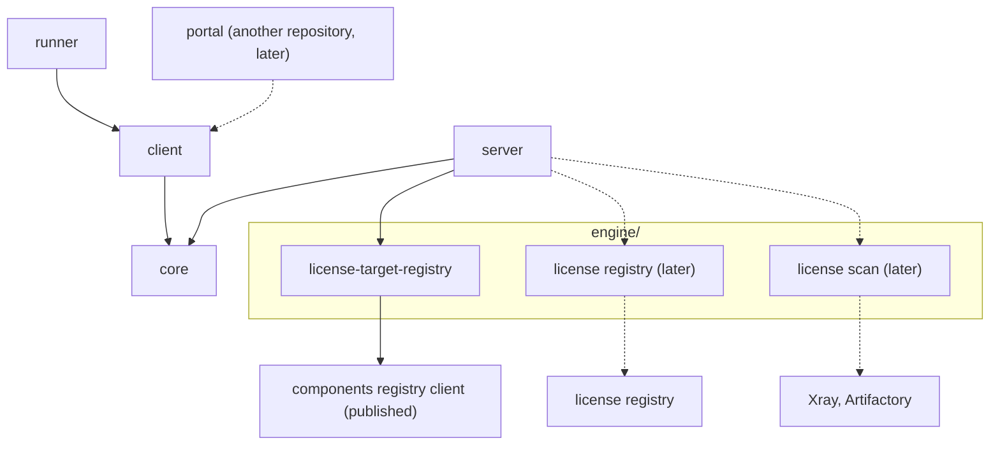

# Architecture

The license service turns a component version into its third-party license files. This page says which module owns what and how a request flows. Class-level detail is left to the code.

## Modules



An arrow means "depends on". Dashed parts do not exist yet.

`engine/` holds the modules that produce a report: what a version releases, the license rules, and the scan that finds each file's licenses. It is a folder, not a module: each part is its own Gradle project, so each reaches only the systems it reads.

| Module | Owns | May depend on | Must never depend on |
| --- | --- | --- | --- |
| `core` | The wire contract: request, report, summary, error envelope, exceptions | nothing | anything |
| `client` | The Feign client for the API | `core` | `server` |
| `runner` | The command line that starts a report, waits for it and writes the files | `client` | `server`, `engine/*` |
| `server` | The Spring Boot service | `core`, `engine/*` | `client`, `runner` |
| `engine/target-registry` (`:license-target-registry`) | What a component version releases, or why it is excluded, from the components registry | the components registry client, `versions-api` | `core`, `server`, Spring, any other system |
| `engine/` license registry (later) | Loading the license rules from the license registry | the license registry's client | `core`, `server`, Spring, any other system |
| `engine/` license scan (later) | Finding each released file's libraries and licenses through Xray and Artifactory, checked against the license rules | Xray and Artifactory clients, the other `engine/` models | `core`, `server`, Spring |

Why each rule:

- **`core` depends on nothing**, because every caller imports it: whatever it depends on, every caller pulls in.
- **`client` and `runner` never see `server` or `engine/`.** A caller needs the HTTP contract, not Spring Boot and Tomcat. The runner talks to the service over HTTP like any other caller.
- **`server` never sees `client` or `runner`.** The service does not call itself and knows nothing about who calls it.
- **`engine/` modules never import `core` or Spring.** They work on their own models, richer than the wire; `server` builds them from configuration and maps their results into `core`.
- **Each `engine/` module reads only its own systems.** `license-target-registry` answers "what the registry declares", so it never needs Artifactory or Xray, and the scan builds on its answer instead of asking the registry again.
- **The scan's logic stays apart from its I/O.** Data goes in and a result comes out, so the algorithm is testable without mocks, the way `component-validation` is in octopus-components-registry-service. `license-target-registry` already has that shape: `impl/describer/` is pure, `impl/RegistryLicenseTargetResolver` is the only I/O.

Gradle enforces the dependency rules: a module cannot import what its build file does not declare. This page holds the reasons.

## Request flow

```
TeamCity step (metarunner)
  runner ──client── POST /rest/api/1/license-reports ──► controller → service
                                                           ├─ license target, from the components registry
                                                           │    unknown → 404, unreachable → 503, nothing stored
                                                           │    excluded → store: report EXCLUDED, done
                                                           ├─ store: report RUNNING
                                                           └─ generator, on a background thread, with the target
                                                                └─ later: Xray, Artifactory, license registry
  runner ──client── GET …/{id} until DONE, EXCLUDED or FAILED
  runner ──client── GET …/{id}/files ──► zip
  runner writes license-report.json and the zip to --output-dir
```

Only `core` types cross the wire, in both directions.

Errors become `{"error": {"code", "message"}}` in one `@RestControllerAdvice`.

## Inside the server

The server's packages are grouped by role, so a new piece has one obvious place:

```
org.octopusden.octopus.license.service
├── controller/      HTTP only: LicenseReportController, advice/ExceptionInfoHandler
├── service/         the use case: LicenseReportService, LicenseReportGenerator, and their impl/
├── state/           what the server keeps in memory, and the jobs that keep it current
│   └── report/      LicenseReportStore and ExpiredReportEvictor: reports until their TTL ends
└── configuration/   properties and wiring
```

| Package | May use | Never uses |
| --- | --- | --- |
| `controller` | `service.LicenseReportService`; only `core` types in and out | `state`, `engine/`, the generator |
| `service`: the report service | `state.report` (add, finish, find), `engine/` `LicenseTargetResolver`, the generator | `controller` |
| `service`: the generator | only what it is given: the license target; later the scan | `state`: an eviction never changes a running generation |
| `state` | its own `@Scheduled` job | `service`, `controller`: state never calls back into the use case |
| `configuration` | everything, to wire it | — |

Dependencies point one way: `controller → service → state`. Nothing hides `state` behind an interface: the store has one implementation, and the tests use it as it is.

What each part does on a request:

- the controller only translates HTTP;
- the service checks the request, resolves the license target, registers the report and runs the generation in the background;
- the generator produces the result from what it was given;
- the report store keeps reports in memory until their TTL ends.

## Boundaries

**Narrow at the edges, never in the middle.** `LicenseReportSummary` is built for callers. The scan algorithm works on much more: every released file, checksums, nested archives, build-info, and the reasons behind a trust level.

- **`engine/` has its own model.** It never uses the `core` DTOs. Otherwise every wire change would ripple into the algorithm, and the algorithm would see only what callers are allowed to see.
- **`engine/` reads the external systems; the server maps.** The server passes the license target into the scan, and maps the scan's result into `core` types and the zip.
- **The `LicenseReportGenerator` implementation is that mapping.** Today it returns an empty `core` summary directly, because no scan exists yet.

The service stores nothing. Each result records its inputs (license registry commit, generation time, service version), so a difference between two results for one version can be explained later.

