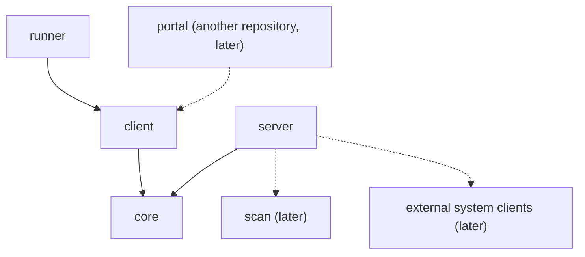

# Architecture

The license service turns a component version into its third-party license files. This page says which module owns what and how a request flows. Class-level detail is left to the code.

## Modules



An arrow means "depends on". Dashed parts do not exist yet.

| Module | Owns | May depend on | Must never depend on |
| --- | --- | --- | --- |
| `core` | The wire contract: request, report, summary, error envelope, exceptions | nothing | anything |
| `client` | The Feign client for the API | `core` | `server` |
| `runner` | The command line that starts a report, waits for it and writes the files | `client` | `server` |
| `server` | The Spring Boot service | `core`, later `scan` and the external system clients | `client`, `runner` |
| `scan` (later) | The license scan algorithm | nothing | Spring, HTTP clients, `core` |

Why each rule:

- **`core` depends on nothing**, because every caller imports it: whatever it depends on, every caller pulls in.
- **`client` and `runner` never see `server`.** A caller needs the HTTP contract, not Spring Boot and Tomcat. The runner talks to the service over HTTP like any other caller.
- **`server` never sees `client` or `runner`.** The service does not call itself and knows nothing about who calls it.
- **`scan` stays pure.** Data goes in and a result comes out. That keeps it testable without mocks, the way `component-validation` is in octopus-components-registry-service.

Gradle enforces the dependency rules: a module cannot import what its build file does not declare. This page holds the reasons.

## Request flow

```
TeamCity step (metarunner)
  runner ──client── POST /rest/api/1/license-reports ──► controller → service
                                                           ├─ store: report RUNNING
                                                           └─ generator, on a background thread
                                                                └─ later: components registry, Xray,
                                                                   Artifactory, license registry
  runner ──client── GET …/{id} until DONE, EXCLUDED or FAILED
  runner ──client── GET …/{id}/files ──► zip
  runner writes license-report.json and the zip to --output-dir
```

Only `core` types cross the wire, in both directions.

Errors become `{"error": {"code", "message"}}` in one `@RestControllerAdvice`.

## Inside the server

The server's packages are grouped by role, so a new piece has one obvious place:

```
org.octopusden.octopus.license.service
├── controller/      HTTP only: LicenseReportController, advice/ExceptionInfoHandler
├── service/         the use case: LicenseReportService, LicenseReportGenerator, and their impl/
├── state/           what the server keeps in memory, and the jobs that keep it current
│   └── report/      LicenseReportStore and ExpiredReportEvictor: reports until their TTL ends
└── configuration/   properties and wiring
```

| Package | May use | Never uses |
| --- | --- | --- |
| `controller` | `service.LicenseReportService`; only `core` types in and out | `state`, the generator |
| `service`: the report service | `state.report` (add, finish, find), the generator | `controller` |
| `service`: the generator | only what it is given | `state`: an eviction never changes a running generation |
| `state` | its own `@Scheduled` job | `service`, `controller`: state never calls back into the use case |
| `configuration` | everything, to wire it | — |

Dependencies point one way: `controller → service → state`. Nothing hides `state` behind an interface: the store has one implementation, and the tests use it as it is.

What each part does on a request:

- the controller only translates HTTP;
- the service checks the request, registers the report and runs the generation in the background;
- the generator produces the result from what it was given;
- the report store keeps reports in memory until their TTL ends.

## Boundaries

**Narrow at the edges, never in the middle.** `LicenseReportSummary` is built for callers. The scan algorithm works on much more: every released file, checksums, nested archives, build-info, and the reasons behind a trust level.

- **`scan` has its own model.** It never uses the `core` DTOs. Otherwise every wire change would ripple into the algorithm, and the algorithm would see only what callers are allowed to see.
- **The server owns both edges.**
  - Inbound: it fetches from the external systems and maps what it gets into the `scan` input.
  - Outbound: it maps the `scan` result into `core` types and the zip.
- **The `LicenseReportGenerator` implementation is that adapter.** Today it returns an empty `core` summary directly, because it reads nothing.

The service stores nothing. Each result records its inputs (license registry commit, generation time, service version), so a difference between two results for one version can be explained later.

