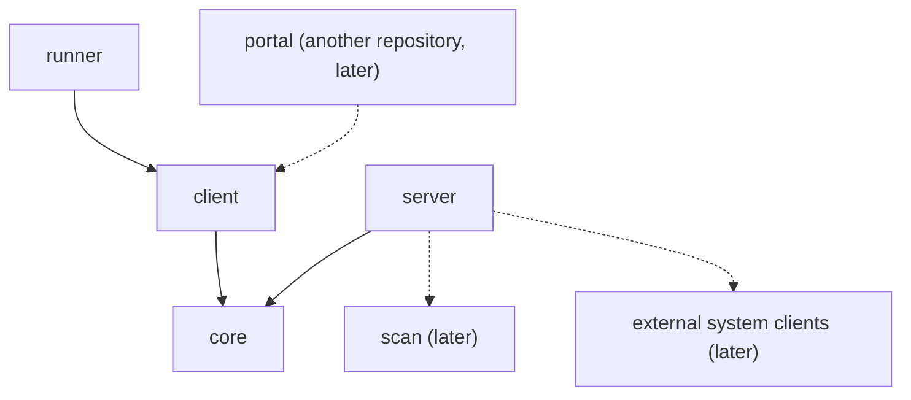

# Architecture

The license service turns a component version into its third-party license files. This page says which module owns what, how a request flows, and why a few choices look the way they do. Class-level detail is left to the code.

## Modules



An arrow means "depends on". Dashed parts do not exist yet.

| Module | Owns | May depend on | Must never depend on |
| --- | --- | --- | --- |
| `core` | The wire contract: request, report, summary, error envelope, exceptions | nothing | anything |
| `client` | The Feign client for the API | `core` | `server` |
| `runner` | The command line that starts a report, waits for it and writes the files | `client` | `server` |
| `server` | The Spring Boot service | `core`, later `scan` and the external system clients | `client`, `runner` |
| `scan` (later) | The license scan algorithm | nothing | Spring, HTTP clients, `core` |

Why each rule:

- **`core` depends on nothing**, because every caller imports it: whatever it depends on, every caller pulls in.
- **`client` and `runner` never see `server`.** A caller needs the HTTP contract, not Spring Boot and Tomcat. The runner talks to the service over HTTP like any other caller.
- **`server` never sees `client` or `runner`.** The service does not call itself and knows nothing about who calls it.
- **`scan` stays pure.** Data goes in and a result comes out. That keeps it testable without mocks, the way `component-validation` is in octopus-components-registry-service.

Gradle enforces the dependency rules: a module cannot import what its build file does not declare. This page holds the reasons.

## Request flow

```
TeamCity step (metarunner)
  runner ──client── POST /rest/api/1/license-reports ──► controller → service
                                                           ├─ store: report RUNNING
                                                           └─ generator, on a background thread
                                                                └─ later: components registry, Xray,
                                                                   Artifactory, license registry
  runner ──client── GET …/{id} until DONE, EXCLUDED or FAILED
  runner ──client── GET …/{id}/files ──► zip
  runner writes license-report.json and the zip to --output-dir
```

Only `core` types cross the wire, in both directions.

In the server:

- the controller only translates HTTP;
- the service checks the request, registers the report and runs the generation in the background;
- the store keeps reports in memory;
- the generator produces the result.

Errors become `{"error": {"code", "message"}}` in one `@RestControllerAdvice`.

## Boundaries

**Narrow at the edges, never in the middle.** `LicenseReportSummary` is built for callers. The scan algorithm works on much more: every released file, checksums, nested archives, build-info, and the reasons behind a trust level.

- **`scan` has its own model.** It never uses the `core` DTOs. Otherwise every wire change would ripple into the algorithm, and the algorithm would see only what callers are allowed to see.
- **The server owns both edges.**
  - Inbound: it fetches from the external systems and maps what it gets into the `scan` input.
  - Outbound: it maps the `scan` result into `core` types and the zip.
- **The `LicenseReportGenerator` implementation is that adapter.** Today it returns an empty `core` summary directly, because it reads nothing.

The service stores nothing. Each result records its inputs (license registry commit, generation time, service version), so a difference between two results for one version can be explained later.

## Decisions

### D-001 Start, poll, download — not one long call
A large component takes minutes. One long HTTP call breaks on proxies and client timeouts. The caller starts a report, polls its status, then downloads the zip.
Rejected: one synchronous call; a callback to the caller, since callers such as TeamCity steps cannot receive one.

### D-002 Finished reports are held in memory, and the TTL starts when the report finishes
The service is stateless. A report lives only long enough to be downloaded (`license-service.report-ttl`, one hour by default), and nothing survives a restart: a caller whose report is gone starts a new one.
- The TTL counts from the end of the generation, so a slow generation never expires before it can be downloaded.
- A running report never expires.

Rejected: a database, because no caller needs history yet; a TTL counted from the start, which loses slow reports.

### D-003 A bounded pool runs the generations
At most `license-service.generation-threads` (4 by default) generations run at once, and the rest wait in a queue. That bounds the load on Xray and Artifactory when a backfill sends hundreds of requests.
Rejected: one thread per request, which is unbounded.

### D-004 The runner is a fat jar on GitHub Packages, with a metarunner
TeamCity resolves the runner by Maven coordinates, which needs a fat jar. Maven Central refuses fat jars, so the release routes the runner to the shared GitHub Packages registry, as octopus-components-registry-service does with `components-registry-automation`. `core` and `client` are real libraries and go to Maven Central. The service ships only as a docker image.

### D-005 The runner knows nothing about TeamCity
- It writes `license-report.json` and the zip to `--output-dir` and prints the summary.
- Problems carry a plain `WARNING:` prefix.
- It always exits 0, because every license step only reports for now.

Publishing artifacts, and reading the service URL and the JDK from `env.LICENSE_SERVICE_URL` and `env.LICENSE_RUNNER_JAVA_HOME`, belong to the metarunner and the build configuration.
Rejected: TeamCity service messages from the runner, which tie it to one CI and, as warnings, only colour a line in the build log.

### D-006 detekt 2, configured in this build
JDK 25 is the target. detekt 1.23.8, the last release octopus-quality configures, crashes on JDK 25, so the build uses detekt 2 and configures it in the root build. octopus-quality still provides ktlint, kover, `qualityStatic`, `qualityCoverage` and the publication checks.
Rejected: running detekt on an older JDK, which splits the toolchain for one tool.

### D-007 Spring Boot 4.0, not 4.1
Spring Cloud 2025.1, the newest GA train, is built on Boot 4.0. The train for Boot 4.1 is still a release candidate. Move to Boot 4.1 together with that train.
