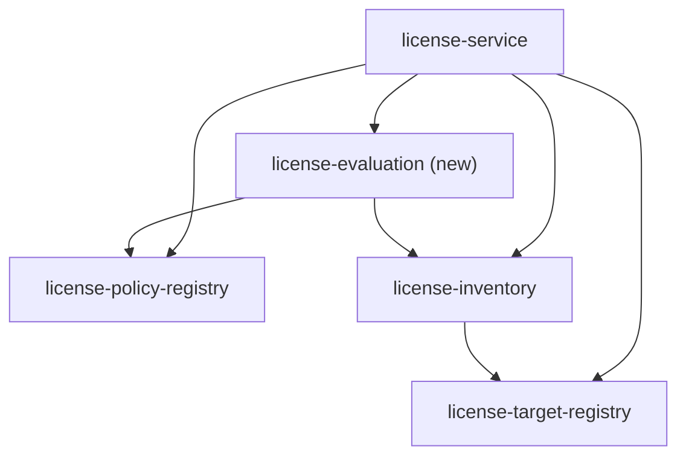

## Context

- `LicenseReportServiceImpl` resolves a `LicenseTarget`, takes the current `LicensePolicy`, and runs `LicenseReportGenerator.generate(target, policy)` on a background thread. `EmptyLicenseReportGenerator` answers zero libraries and an empty zip.
- `:license-inventory` (phase 2) gives `LicenseInventory`: released files with status and evidence, `FoundLibrary` rows (id, licenses as found, evidence, files found in), findings. It does not judge; its parity check against run 14 passes.
- `:license-policy-registry` gives `LicensePolicy.judge(licenses, coordinates?)` → `Judgement(verdict, canonical licenses, overridden)`: override, canonical names, unknown markers, then `ALLOWED`, `NOT_ALLOWED` or `UNKNOWN`.
- `core` already has the summary's shape: `libraryCounts: Map<Verdict, Int>`, `violations: List<Violation(library, verdict, licenses, files)>`, `trust: Trust?`, and `Verdict` with `UNIDENTIFIED`.
- The prototype's stage 11 (`xray_licence_scan.py`, `analyse()` lines 840–871) is what this change ports:

  ```python
  for purl, r in sorted(rows.items()):
      if purl_type(purl) == "docker": continue
      if ptype in OS_PACKAGE_TYPES or (ptype == "pypi" and r["kinds"] == {"docker"}):
          docker_python += ptype == "pypi"; os_by_artifact[entry] += 1 for each entry; continue
      override = override_for(purl, registry); licences = override or r["licences"] or {"Unknown"}
      v = "INTERNAL" if is_internal(purl) else "REVIEW_HASH_ONLY" if purl.startswith("generic://") else verdict(licences, registry)
      if v in ("UNKNOWN", "NOT_ALLOWED"): violation("LICENCE_NOT_ALLOWED", purl, " | ".join(sorted(licences)))
  os_packages_skipped = rows of an OS type; docker_python_skipped; per artifact os_skipped
  ```

- `assess_confidence()` (stage 12) and the CSV outputs are not part of this change.

## Worked example

The inventory of `sample-portal` `2.4.0` (illustrative names, real shapes): a zip `org.example.portal:sample-portal:zip` and an image `sample/portal:2.4.0-118`. The policy allows `Apache-2.0` and `MIT`, and overrides `org.example--sample-lib--[1.0,2.0)=MIT`.

| Library (`FoundLibrary`) | Found in | Licenses found | `ours` | Step that decides | Result |
| --- | --- | --- | --- | --- | --- |
| `pkg:docker/sample/base@sha256__ab12` | image | — | no | type `docker` | dropped, not counted |
| `pkg:rpm/openssl-libs@3.0.7` | image | `OpenSSL` | no | OS type | skipped: image +1, OS total +1 |
| `pkg:pypi/requests@2.31.0` | image only | `Apache-2.0` | no | `pypi`, images only | skipped: image +1, base-image Python +1 |
| `pkg:pypi/attrs@23.2.0` | zip and image | `MIT` | no | `pypi`, not only images | counted, `ALLOWED` |
| `pkg:maven/org.example.portal/portal-plugins@2.4.0-118` | zip | — | yes | ours | `INTERNAL` |
| `generic://sha256:cd34…/vendor-blob.so` | zip | `Unknown` | no | checksum only | `UNIDENTIFIED` |
| `pkg:maven/org.example/sample-lib@1.5` | zip | `GPL-3.0` | no | override holds `1.5` | `ALLOWED`, overridden, `MIT` |
| `pkg:npm/left-pad@1.3.0` | zip | — | no | nothing known | `UNKNOWN` |
| `pkg:maven/org.springframework/spring-core@6.1.4` | zip | `The Apache Software License, Version 2.0` | no | synonym of `Apache-2.0` | `ALLOWED`, `Apache-2.0` |

Summary: `libraryCounts` `ALLOWED 3, NOT_ALLOWED 0, UNKNOWN 1, UNIDENTIFIED 1` (the internal library is not third party); `violations` `generic://sha256:cd34…/vendor-blob.so` (`UNIDENTIFIED`) and `pkg:npm/left-pad@1.3.0` (`UNKNOWN`), each with the zip as its file. Skipped: 1 OS package, 1 base-image Python package, 2 for the image.

## Goals / Non-Goals

**Goals:**
- For the same inventory and the same registry commit, the same verdict per library as the prototype's stage 11, and the same skipped counts, in total and per released file.
- Evaluation is pure: inventory and policy in, assessment out, tested with plain data.
- Every rule has one owner: "what is ours" stays in the inventory, "is this license allowed" stays in the policy, "what counts" is evaluation's.
- The server produces a real summary from the scan and the evaluation, and fails a report when Artifactory or Xray cannot be asked.

**Non-Goals:**
- Trust levels: phase 4 reads the assessment; this change only makes sure the assessment carries what it needs (files, evidence, findings, verdicts).
- License files: the zip stays empty.
- A second judging rule shaped like the prototype's `verdict()` (Decision 6).

## Modules



| Module | Owns | May depend on | Must never depend on |
| --- | --- | --- | --- |
| `engine/evaluation` (`:license-evaluation`) | Which libraries of an inventory count, and the verdict on each | `:license-inventory` (model only), `:license-policy-registry` (model only) | `core`, `server`, Spring, any client, any I/O |

- `:license-inventory` declares its clients `implementation`, so they do not reach evaluation's compile classpath; evaluation uses `LicenseInventory` and its model only.
- Evaluation reads no system. It is the `component-validation` shape: data in, result out.

## Classes and their responsibilities

Package `org.octopusden.octopus.license.evaluation`. `impl/` is `internal`.

```
LicenseEvaluator                     public · evaluate(inventory, policy): LicenseAssessment · orchestration only
├─ model/                            public · LicenseAssessment, AssessedLibrary, LibraryVerdict, SkippedPackages
└─ impl/
   ├─ PackageScope                   pure · counted, skipped (OS package, base-image Python), or dropped (docker layer)
   └─ LibraryJudge                   pure · INTERNAL, UNIDENTIFIED, or the policy's judgement
```

In `:license-inventory` (Part B):

```
impl/shared/Ownership                isOurs(id, copyInOwnRepository): the prototype's is_internal, one place
impl/completing/ChecksumNamer        records the own-repository answer it already asks Artifactory for
impl/shared/LibraryTable             carries `ours` per row into FoundLibrary
model/FoundLibrary                   + ours
```

In `server`:

```
service/impl/EvaluatingLicenseReportGenerator   scan → evaluate → map; counts the scan's outcome
service/impl/SummaryMapper                      pure · LicenseAssessment + policy commit + inputs → core LicenseReportSummary
configuration/                                  ArtifactoryProperties, XrayProperties, OwnershipProperties; scanner and evaluator beans
```

| Class | Kind | One responsibility | Prototype |
| --- | --- | --- | --- |
| `LicenseEvaluator` | orchestrator, pure | Runs `PackageScope` over every library, `LibraryJudge` over the counted ones, assembles the assessment. Decides nothing itself | stage 11 loop |
| `PackageScope` | pure | Whether a library is counted, skipped as an OS package, skipped as base-image Python, or dropped as a docker layer | `ptype == "docker"`, `OS_PACKAGE_TYPES`, `kinds == {"docker"}` |
| `LibraryJudge` | pure | The verdict on one counted library: `INTERNAL`, `UNIDENTIFIED`, or the policy's | `is_internal`, `startswith("generic://")`, `override_for` + `verdict` |
| `LicenseAssessment` | model | The inventory, every counted library with its verdict, the skipped counts | `result["components"]`, `os_packages_skipped`, `docker_python_skipped`, `os_skipped` |
| `Ownership.isOurs` | pure, in inventory | Whether a package id is ours | `is_internal` |
| `SummaryMapper` | pure, in server | Assessment → `core` summary: third-party counts per verdict, violations | summary columns `allowed`, `not_allowed`, `unknown`, `review_hash_only` |
| `EvaluatingLicenseReportGenerator` | orchestrator, in server | Calls the scanner and the evaluator, counts the scan, maps | `run()` |

### Skeletons

```kotlin
class LicenseEvaluator {
    fun evaluate(inventory: LicenseInventory, policy: LicensePolicy): LicenseAssessment
}

data class LicenseAssessment(
    val inventory: LicenseInventory,         // unchanged: grading and the files read it
    val libraries: List<AssessedLibrary>,    // counted libraries only, in the inventory's order (by rendered id)
    val skipped: SkippedPackages,
)

data class AssessedLibrary(
    val library: FoundLibrary,
    val verdict: LibraryVerdict,
    val licenses: List<String>,              // the policy's canonical names; for INTERNAL and UNIDENTIFIED too
    val overridden: Boolean,
) {
    val thirdParty get() = verdict != LibraryVerdict.INTERNAL
}

enum class LibraryVerdict { INTERNAL, ALLOWED, NOT_ALLOWED, UNKNOWN, UNIDENTIFIED }

data class SkippedPackages(
    val osPackages: Int,                     // packages of an OS type, wherever found
    val baseImagePython: Int,                // pypi packages found only in images
    val perFile: Map<String, Int>,           // released file entry → both kinds skipped in it
)

// :license-inventory
data class FoundLibrary(
    val id: PackageId,
    val licenses: Set<String>,
    val evidence: Set<Evidence>,
    val foundIn: Set<String>,
    val ours: Boolean,                       // new
)
```

## Decisions

### 1. A module of its own, `license-evaluation`, pure

- `engine/evaluation` (`:license-evaluation`) owns phase 3 of the component design. It depends on the inventory's model and the policy's model, and reads no system.
- Not in `:license-inventory`: the inventory must not depend on `:license-policy-registry` (its Decision 1); evaluation needs both.
- Not in `server`: the rules would then sit beside Spring and the wire types, and only the server could test them. Phase 4 (grading) is the next consumer of the same assessment and can join this module.
- No interface for `LicenseEvaluator`: it is pure and has one implementation; the server's tests use it as it is, as they use `LicensePolicy`.

### 2. "Ours" is recorded by the inventory, not decided by evaluation

- The prototype's `is_internal` asks Artifactory for a checksum-only file (`is_internal_sha256`: a copy in an `rnd-*local` repository). Evaluation reads no system, so that answer must arrive in the inventory.
- `ChecksumNamer` already asks exactly that question, for exactly those files, before naming them. It records the answer instead of discarding it.
- So the whole rule stays in `Ownership`, in one module: `isOurs(id, copyInOwnRepository)`:
  - a Maven id: its group starts with an internal group (the prototype tests `g:a:v`, the same thing for a group without `:`);
  - a checksum-only id: its file name starts with an internal group and `.`, or a copy with its sha256 sits in one of our repositories;
  - anything else: not ours.
- `FoundLibrary.ours` carries the answer; evaluation only reads it. A renamed checksum-only file is judged by its new Maven id's group, as in the prototype, where naming runs before `is_internal`.
- Rejected: `Ownership` public and a `copyInOwnRepository` fact on `FoundLibrary`. "What is ours" would then be decided in two modules, half each, and could drift.
- This changes the architecture's sentence "whether a library is ours is evaluation's": the inventory now answers it, as a fact of where the file is stored; it still judges no license.

### 3. What counts (`PackageScope`), in the prototype's order

1. Type `docker` (an image layer): dropped. Not counted, not listed, not in any total.
2. Type `rpm`, `deb` or `alpine`: skipped as an OS package.
3. Type `pypi`, and every released file it was found in is an image (`FileKind.DOCKER`): skipped as base-image Python. Xray cannot tell base-image Python (yum, subscription-manager) from an application's.
4. Anything else: counted.

- A skipped library adds one to `perFile` for every released file it was found in; `osPackages` counts rule 2, `baseImagePython` rule 3.
- The type is `PackageId.type`, which the inventory defines as the prototype's `purl_type`.
- "Found only in images" reads the kinds of the released files named in `foundIn`. The prototype records the kind of the outer file a package was found in (`gav` or `docker`); `foundIn` holds the outer file's entry, so the same set.

### 4. The verdict on a counted library (`LibraryJudge`), first match wins

1. `ours` → `INTERNAL`.
2. Rendered id starts with `generic://` → `UNIDENTIFIED`. The prototype tests the rendering, so an `Unrecognized` `generic://` id counts too, not only `ChecksumOnly`.
3. Otherwise `LibraryVerdict` from `policy.judge(licenses, coordinates)`, `coordinates` from a Maven id only.

- The policy is asked for every counted library, `INTERNAL` and `UNIDENTIFIED` too, so `overridden` and `licenses` are filled the same way for all, as the prototype computes `override` and `licences` before choosing the verdict.
- `LicenseVerdict` (the policy's) maps one to one onto `LibraryVerdict`; `INTERNAL` and `UNIDENTIFIED` are evaluation's own.

### 5. Violations are derived, not stored

- The prototype adds a `LICENCE_NOT_ALLOWED` violation for each `UNKNOWN` and `NOT_ALLOWED` library. That is a function of the verdicts, so the assessment does not store it; the parity view derives it.
- The summary follows the `core` contract, which already exists: a violation is a third-party library whose verdict is not `ALLOWED`, so `UNIDENTIFIED` too.
- No new `FindingCode`: findings stay what the scan noticed.

### 6. The policy's judgement, not a copy of the prototype's `verdict()`

- `LicensePolicy.judge` follows the license plugins (load-license-policy, Decisions 5 and 6). It differs from the prototype's `verdict()` in three ways:
  - names: exact first, then ignoring case, the first registry line winning; the prototype ignores case only, the last line winning;
  - overrides: the greatest matching key, ranges by `versions-api`; the prototype takes the first match in file order, ranges by its own parser;
  - allowed: whitelist and hidden list compared after their own canonical names, unknown markers ignoring case; the prototype compares them as written.
- Measured: re-judging run 14's 49,767 judged libraries (all but `INTERNAL` and `REVIEW_HASH_ONLY`) with these rules against the registry (`50085de`) gives 1 different verdict: `pkg:maven/jtidy/jtidy@r872-jdk5`, `NOT_ALLOWED` in the prototype, `ALLOWED` in the service (`JTidy`, spelled in two casings in the registry).
- So evaluation calls the policy. A prototype-shaped judge would be a second rule for "is this license allowed", in the service only to reproduce one verdict.
- The parity check lists such a difference under "policy rules" (Decision 10), not as a failure.

### 7. License names: canonical in the report, compared as found in parity

- `AssessedLibrary.licenses` are the policy's canonical names, sorted, so every report spells a license one way (load-license-policy, Decision 5).
- The prototype printed `override or licences found or {"Unknown"}` as written. Measured on run 14: the service's names differ from that column on 668 of 49,767 judged rows, all with the same verdict but the one in Decision 6.
- Parity compares what decides those names: the licenses as found (`FoundLibrary.licenses`, already the inventory's parity), the verdict and `overridden`. Equal inputs and an equal override give equal names; the rendering is not compared.

### 8. Ordering and totals

- `libraries` keep the inventory's order (sorted by rendered id), as the prototype iterates `sorted(rows.items())`.
- `osPackages` counts every row of an OS type, as the prototype's `os_packages_skipped`; `baseImagePython` only rule 3 of Decision 3, as `docker_python_skipped`.
- `perFile` has an entry only for a file with something skipped; a missing entry is zero, as the prototype's `os_by_artifact.get(entry, 0)`.

### 9. The server

- `EvaluatingLicenseReportGenerator(scanner, evaluator, clock, buildProperties, meterRegistry)` replaces `EmptyLicenseReportGenerator`:
  1. `scanner.scan(target)`; `InventorySourceUnavailableException` is counted `unavailable` and rethrown, so the report ends `FAILED` with its message (the service's existing failure path);
  2. `evaluator.evaluate(inventory, policy)`;
  3. `SummaryMapper.map(assessment, inputs)`; the zip stays empty until the license files change.
- `SummaryMapper`:
  - `libraryCounts`: every `core` `Verdict` with the number of third-party libraries of that verdict, zero included, so a caller never tells "none" from "absent";
  - `violations`: every third-party library not `ALLOWED`, in the assessment's order: rendered id, verdict, canonical licenses, `foundIn` sorted;
  - `trust`: `null`.
- `license.inventory.scans{outcome}` (`license_inventory_scans_total`): `scanned`, `unavailable`, `failed` (any other exception). No health indicator: Artifactory and Xray are per-request dependencies shared by every pod (architecture, Health and metrics).
- One `JfrogLicenseInventoryScanner` and one `LicenseEvaluator` bean serve every generation thread; neither keeps state between calls.

### 10. Configuration

- A system the service reads is configured under the key every service shares, as dms-service and release-management-service do, not under `license-service`:
  - `components-registry-service.url`, `bitbucket.host`, `artifactory.url`: set once in Spring Cloud Config's `application.yml`; `artifactory.url` is the JFrog platform's, so it serves Xray too;
  - `bitbucket.token`, `artifactory.token`: from Vault.
  - One `@ConfigurationProperties` class per system (`ComponentsRegistryServiceProperties`, `BitbucketProperties`, `ArtifactoryProperties`).
- Only what is this service's own stays under `license-service`, in a `license-service.yml` of Spring Cloud Config:
  - `license-registry.project`, `license-registry.repository`, `exclusions`;
  - `ownership.internal-groups`, `ownership.own-repository-prefixes`: required, non-empty: company names stay out of this public repository;
  - `xray.scan-timeout` (default `PT5M`), `xray.scan-poll-interval` (default `PT10S`).
- Found on review: the earlier changes put every system under `license-service` (`components-registry-url`, `license-registry.bitbucket-url` and `token`), unlike every other service. Moved here, before anything was configured for the service in Spring Cloud Config.
- Missing or blank: the service does not start, and the message names the property.
- `application.yaml` holds the defaults and a comment saying where the rest comes from; `bootstrap-dev.yml` reads every required value from an environment variable, with the names the parity checks already use (`COMPONENTS_REGISTRY_URL`, `BITBUCKET_URL`, `BITBUCKET_TOKEN`, `JFROG_URL`, `JFROG_TOKEN`, …).

### 11. Parity, end to end

- `:license-inventory` gets `java-test-fixtures`; `ParityView` and `ParityDiff` move from its `test` source set into `testFixtures`, unchanged. Its own `parityTest` keeps working.
- `:license-evaluation` gets a `parityTest` source set and task, never part of `check`, the same shape as the inventory's (its Decision 16):
  - input: `PROTOTYPE_RUN_DIR` from a local prototype run made just before, plus the inventory's environment and the license registry's (`BITBUCKET_URL`, `BITBUCKET_TOKEN`, `LICENSE_REGISTRY_PROJECT`, `LICENSE_REGISTRY_REPOSITORY`, as in `bootstrap-dev.yml`);
  - per component: resolve, scan, evaluate with the policy loaded once at the start;
  - compared: the inventory view (as today), then per library `verdict` (prototype `REVIEW_HASH_ONLY` read as `UNIDENTIFIED`) and `overridden`; `os_packages_skipped`, `docker_python_skipped`; `os_skipped` per artifact; the `LICENCE_NOT_ALLOWED` subjects, derived from the verdicts;
  - a verdict difference whose found licenses and override agree is reported under "policy rules" (Decision 6), separately from the rest;
  - output: `build/parity/report.md`, one line per component, then each difference. Done means no difference outside Decision 6.
- The prototype's run should use the same registry commit as the policy the service loads: both read `master` at the time of the run.

### 12. Package rules, held by a test

- `PackageDependencyTest` in `:license-evaluation`: `model` imports nothing of `impl`; nothing imports a client, Spring or `core` (Gradle already forbids the last two; the test names the rule).
- `:license-inventory`'s `PackageDependencyTest` is unchanged: `Ownership` stays in `impl/shared`.

## Out of Scope

- Grading (`assess_confidence`, `assess_artifacts`): it needs the assessment and nothing else from this change; per-file counts are computed there.
- License files: the policy already has the texts (`LicensePolicy.text`); writing them is its own change.
- The prototype's summary columns other than the verdict counts (`only_in_build_info`, `only_in_xray`, `scanned_artifacts`, `build_agents`): grading inputs.
- Making the policy prototype-shaped (Decision 6).

## Risks / Trade-offs

- **One verdict differs from run 14 by design.** The parity check reports it under "policy rules"; the registry can remove it by spelling `JTidy` one way. Accepted: one judging rule for every caller.
- **The inventory now answers "ours".** A later reader may expect it in evaluation, as the component design first drew it; the design and `docs/architecture.md` say where it is and why (Decision 2).
- **A report now takes as long as a scan.** Up to 5 minutes more while Xray finishes, with 4 generation threads; queued reports wait. Accepted for the report-only rollout; threads and timeout are configuration (inventory, Decision 12).
- **A report can now fail on Artifactory or Xray.** The runner already logs `FAILED` as a warning (`BuildLog`); the counter shows outages.
- **Parity depends on a fresh prototype run.** Artifactory, Xray and the registry move; a stale run shows false differences. Mitigated as in phase 2: run the prototype locally right before.
