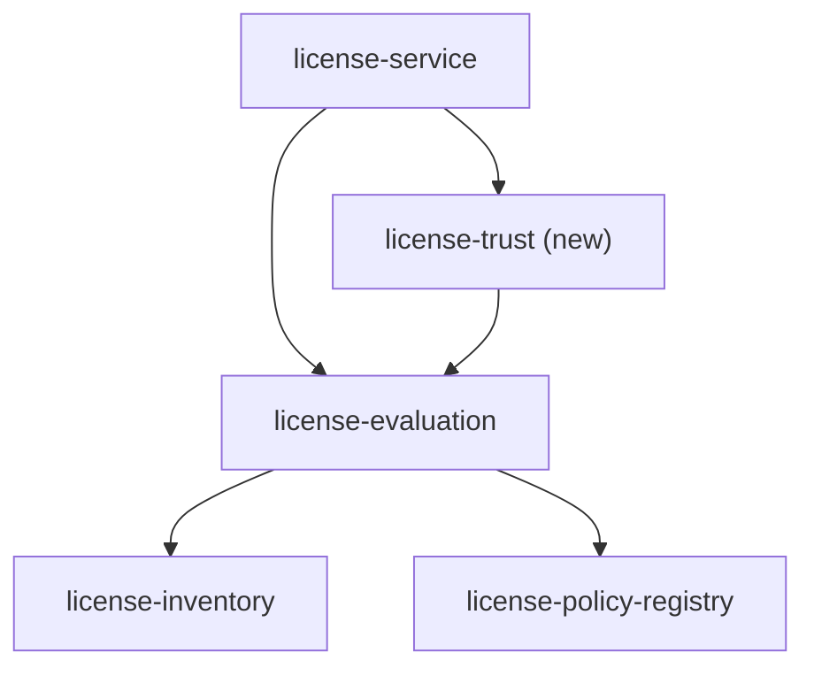

## Context

**What exists today**

- `:license-evaluation` gives a `LicenseAssessment`, which holds:
  - the inventory, unchanged: released files with status, evidence and build, findings in the order found, libraries with their evidence and `foundIn`;
  - every counted library with its verdict;
  - the skipped counts.
- Its parity check against run 14 passes. The only differences are the ones listed as "policy rules" or "deliberate".
- `LicenseTarget.labels` holds the registry labels (`java`, `javascript`, `cpp`…) of the requested version. The prototype reads the component's labels (`/components/{id}`, the current configuration). The two are the same unless the labels changed between versions.
- `core` already has `Trust(level, reasons)`, `TrustReason(reason, fix)` and `TrustLevel`. `SummaryMapper` sets `trust = null`.
- The runner's `BuildLog` prints `Trust: <level>` and one line per reason, and warns on `LOW` and `NONE`. It prints "Trust: not computed" while trust is null.

**What this change ports**

The prototype's stage 12 (`xray_licence_scan.py` lines 875–1080):

- `assess_confidence(r)` collects reasons for the component in a fixed order. Its level is the lowest level among the reasons, or `HIGH` when there are none.
- `assess_artifacts(r, labels, third)` gives each selected file its own flags and level. These do not lower the component's level.
- `REASONS` maps each code to a level, title, meaning and fix.
- `NOT_ANALYSED_TYPES` maps a scan violation to a reason, used when nothing was read.
- `ARTIFACT_STATUS_REASON` maps a file status to a reason.
- `LABEL_ECOSYSTEMS`, `NATIVE_LABELS` and `COMPLETE_TYPES` hold the ecosystem knowledge.
- The thresholds:
  - checksum-only: at least 10, and at least 10 % of the third-party libraries;
  - unknown license: at least 5, and at least 10 %.

The "License Scan Algorithm" walkthrough describes the same stage. Where the two disagree, the code at `e380518` wins: the walkthrough predates the last three prototype commits, which dropped the Java and C/C++ ecosystem reasons and restored `NOT_ANALYSED_TYPES`.

## Worked example

`sample-portal` `2.4.0` has the labels `java` and `javascript`. Names are illustrative; the shapes are real.

| Released file | Status, evidence | Third-party libraries in it | File reasons | File level |
| --- | --- | --- | --- | --- |
| `org.example.portal:sample-portal:zip` | `READ`, binary scan and build record | 42: 6 `UNKNOWN`, 2 `UNIDENTIFIED` | `UNKNOWN_LICENSES` (6 ≥ 5 and 6 ≥ 4.2) | `MEDIUM` |
| `sample/portal:2.4.0-118` | `READ`, binary scan only | none (OS packages only, which are skipped) | `NO_BUILD_RECORD`, `NO_THIRD_PARTY_FOUND` | `LOW` |
| `org.example.portal:sample-portal-config:yaml` | `PLAIN_FILE` | — | — | `HIGH` |
| `org.example.portal:sample-legacy:jar` (declared) | `NOT_FOUND` | — | `ARTIFACT_NOT_FOUND` | `NONE` |

The component's reasons, in rule order:

1. **Coverage:** 3 files are covered (2 read, plus 1 plain file) of 4 selected. This gives `PARTIAL_ARTIFACTS` (`LOW`), "3 of 4 registered artifacts checked".
2. **Empty content:** there are 42 third-party libraries, so no reason.
3. **Ecosystems:**
   - `javascript` expects `npm`, and none was found. This gives `ECOSYSTEM_NOT_DETECTED` (`LOW`), "missing npm (label javascript); detected maven 40, generic 2".
   - Every type found (`maven`, `generic`) can be listed completely, so there is no `FULL_LIST_UNAVAILABLE`.
4. **Sources:** the image has no build record. This gives `NO_BUILD_RECORD` (`MEDIUM`), "no build for: sample/portal:2.4.0-118".
5. **Identification:**
   - 2 checksum-only libraries is below 10, so no reason.
   - 6 of 42 have no known license. This gives `UNKNOWN_LICENSES` (`MEDIUM`), "6 of 42 outside libraries have no known license".

The component level is `LOW`. The `NONE` file does not lower it: the component sees the missing jar only through `PARTIAL_ARTIFACTS`, as in the prototype.

## Goals / Non-Goals

**Goals:**

- For the same assessment and the same labels, the prototype's level, reasons (code and detail) and per-file level and codes.
- Grading is pure. The assessment and the labels go in, the grade comes out, and it is tested with plain data.
- One class per question the prototype asks. Each threshold, level and text has a single owner.
- Every `DONE` report carries trust, and the runner shows it.

**Non-Goals:**

- Better rules. This is a port, and any improvement is a change of its own after parity.
- Failing a build on trust. Every step only reports.

## Modules



| Module | Owns | May depend on | Must never depend on |
| --- | --- | --- | --- |
| `engine/trust` (`:license-trust`) | Whether the library list of a component version, and of each released file, is complete; the reasons and fixes | `:license-evaluation` (its model, and through it the inventory's) | `core`, `server`, Spring, any client, any I/O, `:license-policy-registry`'s policy logic |

## Classes and their responsibilities

Everything is in package `org.octopusden.octopus.license.trust`, and everything under `impl/` is `internal`: outside `impl/` is what the server may use. Inside, `impl/` is grouped by role, as the inventory's is: what both graders read, the component's grading, the file's grading.

```
TrustGrader                      public · grade(assessment, labels): TrustGrade · wiring only
├─ model/                        public · TrustGrade, TrustReason, TrustReasonCode, TrustLevel, FileTrust
└─ impl/
   ├─ shared/                    what both graders read
   │  ├─ GradingSubject          pure · the facts every rule reads, computed once from the assessment
   │  └─ IdentificationShare     pure · the two thresholds, for the component and for each file
   ├─ component/                 the component's reasons
   │  ├─ ComponentGrader         runs the rules in the prototype's order, each reason once
   │  ├─ ComponentRule           fun interface · reasons(subject): List<TrustReason>
   │  └─ rule/
   │     ├─ CoverageRule         was every selected file covered? (NOT_ANALYSED_TYPES, PARTIAL_ARTIFACTS)
   │     ├─ EmptyContentRule     read, yet no third-party library? (NO_THIRD_PARTY_FOUND)
   │     ├─ EcosystemRule        a labelled language missing, or a type only an SBOM lists? (ECOSYSTEM_NOT_DETECTED, FULL_LIST_UNAVAILABLE)
   │     ├─ SourceRule           which sources saw inside the read files? (NO_BUILD_RECORD, BUILD_LIST_ONLY)
   │     └─ IdentificationRule   too many unnamed or unlicensed? (UNIDENTIFIED_BINARIES, UNKNOWN_LICENSES)
   └─ file/
      └─ FileGrader              one released file's codes (assess_artifacts)
```

| Class | Kind | One responsibility | Prototype |
| --- | --- | --- | --- |
| `TrustGrader` | orchestrator, pure | Builds the subject, asks `ComponentGrader` for the reasons and `FileGrader` for each file. Decides nothing itself | `assess_confidence` and `assess_artifacts` calls |
| `ComponentGrader` | orchestrator, pure | Runs the component rules in order, removes duplicate reasons | `assess_confidence` body |
| `GradingSubject` | pure value | Selected, read and covered files; third-party libraries; whether any counted library was seen in an SBOM; labels; findings | `scanned`, `covered`, `third`, `types`, `has_sbom` |
| `CoverageRule` | rule | Nothing covered: a reason per mapped scan finding, or `NOT_SCANNABLE`. Some covered: `PARTIAL_ARTIFACTS` | `NOT_ANALYSED_TYPES` loop, `PARTIAL_ARTIFACTS` |
| `EmptyContentRule` | rule | Files read, no third-party library; adds the C/C++ note from the labels | `NO_THIRD_PARTY_FOUND`, `NATIVE_LABELS` |
| `EcosystemRule` | rule | A labelled language has no package of its types; a type found that only an SBOM lists completely | `LABEL_ECOSYSTEMS`, `COMPLETE_TYPES` |
| `SourceRule` | rule | Read files without a build record; read files the binary scanner could not see | `NO_BUILD_RECORD`, `BUILD_LIST_ONLY` |
| `IdentificationRule` | rule | Checksum-only share and unknown-license share of the third-party libraries | `UNIDENTIFIED_BINARIES`, `UNKNOWN_LICENCES` |
| `IdentificationShare` | pure | Whether a count among a total crosses each threshold | `>= 10 and >= 0.1 * n`, `>= 5 and >= 0.1 * n` |
| `FileGrader` | pure | Reason codes of one selected file from its status, evidence and own libraries | `assess_artifacts`, `ARTIFACT_STATUS_REASON` |
| `TrustReasonCode` | model | Each code's level, title, meaning and fix | `REASONS` |

### Skeletons

```kotlin
class TrustGrader {
    fun grade(assessment: LicenseAssessment, labels: Set<String>): TrustGrade
}

data class TrustGrade(
    val reasons: List<TrustReason>,          // rule order, no (code, detail) twice
    val files: List<FileTrust>,              // selected files only, in listing order
) {
    val level: TrustLevel get() = TrustLevel.lowest(reasons.map { it.code.level })
}

data class TrustReason(val code: TrustReasonCode, val detail: String)

data class FileTrust(val entry: String, val reasons: List<TrustReasonCode>) {
    val level: TrustLevel get() = TrustLevel.lowest(reasons.map { it.level })
}

enum class TrustLevel {
    NONE, LOW, MEDIUM, HIGH;                 // declaration order is the order of trust
    companion object { fun lowest(levels: Collection<TrustLevel>): TrustLevel }  // HIGH when empty
}

enum class TrustReasonCode(val level: TrustLevel, val title: String, val meaning: String, val fix: String) {
    NO_ARTIFACT_IN_REGISTRY, ARTIFACT_NOT_FOUND, NOT_SCANNABLE,                          // NONE
    PARTIAL_ARTIFACTS, NO_THIRD_PARTY_FOUND, ECOSYSTEM_NOT_DETECTED,
    FULL_LIST_UNAVAILABLE, BUILD_LIST_ONLY,                                              // LOW
    UNIDENTIFIED_BINARIES, UNKNOWN_LICENSES, NO_BUILD_RECORD,                            // MEDIUM
}

internal fun interface ComponentRule {
    fun reasons(subject: GradingSubject): List<TrustReason>
}
```

## Decisions

### 1. A module of its own, `license-trust`, pure

- `engine/trust` (`:license-trust`) owns phase 4. It depends on `:license-evaluation` for the assessment and reads no system.
- **Not in `:license-evaluation`.** Evaluation answers "is this library allowed". Trust answers "is this list complete". They are different questions:
  - they read different facts: verdicts against files, sources and labels;
  - they produce different outputs;
  - they change for different reasons.
  
  Folding trust in would give evaluation two public entry points and a second rule set in one `impl/`. This goes beyond what the evaluation design's Decision 1 anticipated ("can join this module"). It is reconsidered here because trust has nine classes of its own.
- **Not in `server`.** For the same reason as evaluation: the rules would sit next to Spring, and only the server could test them.
- **No interface for `TrustGrader`.** It is pure and has one implementation.

### 2. Each reason code owns its level and texts

- `TrustReasonCode` is the prototype's `REASONS` table as an enum: `level`, `title`, `meaning`, `fix`. A reason's level is `code.level` and is never stored twice. `TrustGrade.level` and `FileTrust.level` are derived from it.
- The texts live in the engine, next to the rule that raises the code. The fix is part of the requirement ("each reason and its recommended fix"), so it must change together with the rule, not in a mapper in `server`.
- The texts are the prototype's, with three changes:
  - "licence" is spelled "license", in `UNKNOWN_LICENSES` too;
  - `PARTIAL_ARTIFACTS`'s fix ends "(see the files' trust)" instead of naming the prototype's "Pipeline issues" tab;
  - `NOT_SCANNABLE`'s meaning keeps its examples.
- `ERROR` and `NEVER_BUILT` are not ported:
  - a generation that fails ends `FAILED` with no summary;
  - a caller always names the version.

  Neither code can be reached.
- `core` carries the code as its name, a string, not as an enum of its own (Decision 8). `SummaryMapper` writes `code.name`; engine modules never import `core` (architecture).

### 3. The prototype's facts, read from the assessment

| Prototype | Service |
| --- | --- |
| artifact selected (status not `NOT_SELECTED`, `SKIPPED_METADATA`) | `ReleasedFile.status` not `NOT_SELECTED`, `METADATA` |
| `registered_artifacts` | number of selected files |
| `a["read"]` | `status == READ` |
| `a["plain_file"]` | `status == PLAIN_FILE` |
| `a["no_build"]` | `BUILD_RECORD !in evidence` (read files) |
| status `BUILD_INFO_ONLY` | `READ` and `BINARY_SCAN !in evidence` |
| status `UNSUPPORTED`, `NOT_FOUND`, `NOT_IN_XRAY` | `UNSUPPORTED`, `NOT_FOUND`, `NOT_READABLE` |
| `a["build"]` | `ReleasedFile.build` |
| `r["components"]` (`cs`) | `assessment.libraries` |
| `third` | `libraries` whose verdict is not `INTERNAL` |
| `c["type"]` | `library.id.type` |
| `"sbom" in c["sources"]` | `SBOM in library.evidence` |
| `a["entry"] in c["artifacts"]` | `entry in library.foundIn` |
| `REVIEW_HASH_ONLY` | `UNIDENTIFIED` |
| `r["violations"]` with a `NOT_ANALYSED_TYPES` code | `inventory.findings` with that code, in the order found |
| `r["labels"]` | `LicenseTarget.labels` |

- `GradingSubject.of(assessment, labels)` computes these facts once. Every rule reads the same "read", "third-party" and "selected", so no two rules can drift apart on what a word means.

### 4. Component rules: one class per question, in the prototype's order

- `ComponentGrader` holds `listOf(CoverageRule, EmptyContentRule, EcosystemRule, SourceRule, IdentificationRule)`. The concatenated reasons follow the prototype's order.
- `ComponentGrader` and `FileGrader` are counterparts: one gives the component's reasons, the other a file's codes. They never import each other and meet only in `impl/shared`, so a file's codes cannot leak into the component's reasons (Decision 5).
- Duplicate `(code, detail)` pairs are dropped, keeping the first, as the prototype's `reason()` does.
- A rule returns reasons and never a level.
- Each detail string is the prototype's, character for character, apart from the "license" spelling:
  - `CoverageRule`:
    - with nothing covered, one reason per finding whose code is `NO_DISTRIBUTION` or `UNSUPPORTED_DISTRIBUTION_ENTRY` (both give `NO_ARTIFACT_IN_REGISTRY`), `ARTIFACT_NOT_FOUND` (`ARTIFACT_NOT_FOUND`), or `NOT_IN_XRAY` or `NO_BUILD_INFO` (`NOT_SCANNABLE`), with the detail `"{subject}: {detail}"`;
    - if there is no such finding: `NOT_SCANNABLE`, "no registered artifact could be scanned";
    - with 0 < covered < selected: `PARTIAL_ARTIFACTS`, `"{covered} of {selected} registered artifacts checked"`;
    - "covered" means read files plus plain files: plain text cannot hold libraries.
  - `EmptyContentRule`: some file read and no third-party library gives `"{read} file(s) checked, 0 outside libraries"`, plus `" (C/C++ build)"` when the labels hold `c` or `cpp` (Decision 6).
  - `EcosystemRule`:
    - for each label of `LABEL_ECOSYSTEMS`, in sorted order, when some file was read and no third-party library has one of its types: group the labels under their sorted types joined with `/`; the groups keep the order of their first label;
    - detail: `"missing {types} (label {labels…}), …; detected {type} {n}, …"`, or `"detected nothing"`;
    - the "detected" list is by count descending, and ties keep the order in which each type first appears among the third-party libraries (sorted by rendered id). This is Python's `Counter.most_common`, and it decides the text.
    - Types outside `COMPLETE_TYPES`, when no counted library (ours included) has `SBOM` evidence: `"found {types, sorted} libraries, but no SBOM"`.
  - `SourceRule`: read files without a build record give `"no build for: {entries, space-separated, in listing order}"`. Read files without a binary scan give `"not indexed in Xray: {entries}"`.
  - `IdentificationRule`: `"{n} of {third} outside files identified by checksum only"`, and `"{n} of {third} outside libraries have no known license"`.
- Trust grades only what evaluation counted. Evaluation's scope therefore decides what a label can find (evaluation design, Decision 3.3): Python found only in images by the image scan is skipped as base-image Python, so a `python` label finds no `pypi` and raises `ECOSYSTEM_NOT_DETECTED`; Python the build declared is counted, so the label is satisfied. The prototype skips both, so the declared case is listed under "follows from evaluation" in parity (Decision 10). `EvaluatedTrustTest` runs the real evaluator before the grader to hold this.
- `LABEL_ECOSYSTEMS`, `NATIVE_LABELS` and `COMPLETE_TYPES` are private constants of the rule that reads them. A label or type the prototype does not know is not matched, as in the prototype.

### 5. File grading (`FileGrader`)

- Only selected files are graded. `NOT_SELECTED` and `METADATA` files get no `FileTrust`, as the prototype leaves their level empty.
- The codes, in this order:
  1. by status: `UNSUPPORTED` gives `NO_ARTIFACT_IN_REGISTRY`, `NOT_FOUND` gives `ARTIFACT_NOT_FOUND`, `NOT_READABLE` gives `NOT_SCANNABLE`, and `READ` without a binary scan gives `BUILD_LIST_ONLY`;
  2. for a `READ` file:
     - `NO_BUILD_RECORD` without a build record;
     - `NO_THIRD_PARTY_FOUND` with no third-party library in it;
     - `UNIDENTIFIED_BINARIES` and `UNKNOWN_LICENSES` by `IdentificationShare` over its own third-party libraries.
- A `PLAIN_FILE` file has no codes, so its level is `HIGH`.
- A file's level never lowers the component's. The component sees file problems only through its own rules, as in the prototype, where `confidence` reads `reasons` only.
- So a component can be `HIGH` while one of its files is `LOW`: a read file with nothing found inside, for one. Nothing reads either level for a build outcome today. When enforcement is switched on, its rule must say which level it reads, the component's or the lowest file's (raised on review).

### 6. The C/C++ note comes from the labels only

- The prototype adds "(C/C++ build)" when the labels hold `c` or `cpp`, **or** a read file was built by one particular internal C/C++ build. The service keeps the label check and drops the build-name check.
- Every component built by that build carries the `c` label in the components registry, so the label alone gives the same note.
- **Rejected: a `native-builds` setting.** It was a setting for one sentence of text.
- **Rejected: hard-coding the build name.** It is an internal name in a public repository.
- The note never changes a level. If a component is built by it without the `c` label, parity shows it as a detail difference, and the fix is the label.

### 7. One owner for the identification thresholds

- `IdentificationShare` holds the two thresholds: unidentified at 10 or more and at least 10 %, unknown at 5 or more and at least 10 %. `IdentificationRule` and `FileGrader` both call it.
- The point of the extraction is that the component and the file must never disagree about what "too many" means. The two places must not diverge, which is a different reason from reuse.
- "At least 10 %" is `n >= 0.1 * total` in `Double`, the prototype's comparison exactly. An integer form would be cleaner, but any rounding difference would be a parity difference.

### 8. The wire contract

```kotlin
data class Trust(val level: TrustLevel, val reasons: List<TrustReason>, val files: List<FileTrust>)
data class TrustReason(val code: String, val level: TrustLevel, val title: String,
                       val detail: String, val meaning: String, val fix: String)
data class FileTrust(val file: String, val level: TrustLevel, val reasons: List<String>)   // codes by name
```

- `LicenseReportSummary.trust` becomes non-null. Every finished report is graded.
- `TrustReason.reason` is gone. It held one text, and a caller needs the code to act on and the detail to locate the problem.
- The code is a string on the wire, not an enum. Rules are expected to change after parity, and a new code must not break a client built before it existed: every reason already carries its level, title, meaning and fix, so a client never needs the code table. Changed on review; `core`'s `TrustReasonCode` enum is gone. `Verdict` stays an enum: its values follow the license registry's, which do not grow.
- The level is repeated on each reason and file on the wire, so a caller need not know the code table.
- File reasons are codes only, as the prototype's `flags`. The component's reasons carry the details.

### 9. The server and the runner

- `EvaluatingLicenseReportGenerator(scanner, evaluator, grader, …)` runs: scan, then `evaluator.evaluate(inventory, policy)`, then `grader.grade(assessment, target.labels)`, then `SummaryMapper.map(assessment, grade, inputs)`.
- `SummaryMapper` maps `TrustGrade` to `Trust` one to one. Counts and violations are unchanged.
- One `TrustGrader` bean serves every generation thread. It keeps no state between calls.
- `BuildLog`:
  - `Trust: <level>`;
  - per reason: `  <level> <title>: <detail>. Fix: <fix>`;
  - per file below `HIGH`: `  <file>: <level> (<codes>)`.
  
  These lines are warnings when the component's level is `LOW` or `NONE`, as today. The runner's exit code never depends on trust.

### 10. Parity, end to end

- `:license-evaluation` gets `java-test-fixtures`. `EvaluationParityView` and `EvaluationParityDiff` move into them, unchanged.
- `:license-trust` gets a `parityTest` source set and task, never part of `check`, with the same shape and environment as the evaluation's.
- For each component it:
  1. resolves, scans, evaluates and grades;
  2. compares the inventory and the evaluation as today;
  3. compares the trust view:
     - `level` against the prototype's `confidence`;
     - `reasons` as a set of `(code, detail)`, the prototype's `UNKNOWN_LICENCES` read as `UNKNOWN_LICENSES` and "licence" as "license" in details;
     - files: entry to `(level, codes)` for every selected file, against `level` and `flags`.
- **Reasons are compared as a set, not a list.** The inventory compares findings as a set, because the scan's lookups can find them in a different order. `CoverageRule` follows the findings' order, so the order can differ while the content is the same.
- **When a component already has a "policy rules" or "deliberate" evaluation difference,** its trust differences are listed as "follows from evaluation" and do not fail. Either difference changes a count grading reads (third-party libraries, unknown licenses, types, SBOM seen).
- Prototype components with `error` or with no `version` are skipped and named in the report. The service has no grade to compare for them (Decision 2).
- Output: `build/parity/report.md`, adding a trust column. Done means no difference outside those listed, and the reference components named in the ticket the same.

### 11. Package rules, held by a test

- A `PackageDependencyTest` in `:license-trust` checks that:
  - `model` imports nothing from `impl`;
  - nothing imports a client, Spring, `core`, `java.io` or `java.net`, or the `impl` of the evaluation, the inventory or the policy;
  - `impl/component` and `impl/file` never import each other, and `impl/shared` imports neither.

## Out of Scope

- **Changing a threshold, a level or a text beyond Decision 2:** a story after parity.
- **Per-file counts on the wire** (third-party, allowed, hash-only per file): no caller needs them to decide anything. Grading computes them internally.
- **A metric per trust level:** nobody has asked for one yet.
- **The license files:** a change of their own.

## Risks / Trade-offs

- **The prototype's rules are carried over as they are, oddities included.** Examples:
  - an image holding only OS packages is `NO_THIRD_PARTY_FOUND` at file level;
  - a missing declared file lowers the component only through `PARTIAL_ARTIFACTS`.

  This is accepted because parity is the goal. Revisiting them belongs with TD-002, measured with the parity check.
- **The detail strings are part of parity.** A reworded detail would show up as a difference. This is intended: the details are what a developer reads to find the file.
- **A trust difference can hide behind an evaluation difference** (Decision 10). The excused components are few, and they are named in the report. They are not silently dropped.
- **Labels per version, not per component.** The service grades with the labels of the requested version, and the prototype with the component's current ones. For the latest version they are the same. For an older version the service is the more correct one. A parity difference from this shows up as `ECOSYSTEM_NOT_DETECTED` or a C/C++ note, and it is named in the report.
- **A regular build will often grade `BUILD_LIST_ONLY` (LOW).** A `CHECK` report, a regular build's, does not wait for Xray (evaluation design, Decision 9). A file uploaded seconds before is then usually not indexed yet, so it is read from its build record only, and the component and the file get `BUILD_LIST_ONLY`. RC and RELEASE (`FULL`) wait up to 5 minutes and are not affected. The grade stays honest; the runner, for a `CHECK` only, does not warn on that reason and replaces its fix with "Xray has not indexed it yet; the full report at RC or RELEASE waits for it", so the warnings left in a regular build (real violations, other reasons) are worth reading. Found on review: a warning on every build, with a fix that is wrong for a file merely not indexed yet, would teach people to skip the block.
- **A summary read before Xray finished.** A full report reads the summary when its wait runs out, whatever the status says; a check reads it at once. Watched against the real Xray (tasks 6d.6): while a file is not yet indexed, the summary answers an error, already graded as not indexed; once it answers, it already holds the full list, even while the status still says `SCANNING`. No partial list was seen in 9 files from upload to `DONE`, so no reason is added for "still pending". A small sample: if a partial answer ever shows up, the scan has to keep "pending at the deadline" as a finding first, and trust reads it.
- **`TrustReason` changes shape on the wire.** It is safe now because no caller reads it: it was always null. After this change it is part of the contract.
