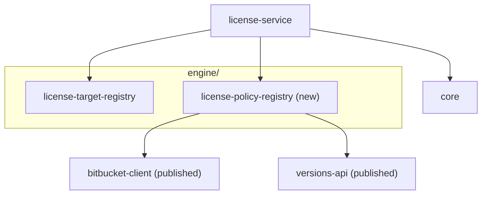

## Context

- `LicenseReportServiceImpl.start` resolves the license target, then hands it to `LicenseReportGenerator` on a background thread. `EmptyLicenseReportGenerator` returns zero counts and `GenerationInputs(licenseRegistryCommit = null, …)`.
- `core` already carries `Verdict` (`ALLOWED`, `NOT_ALLOWED`, `UNKNOWN`, `UNIDENTIFIED`) and `GenerationInputs.licenseRegistryCommit`; nothing fills them.
- The license registry is a Git repository on Bitbucket. Its default branch is `master`. Files at its root:
  - `licenses-whitelist.txt`, `licenses-hidden.txt`: one line, names separated by `|`;
  - `merges.txt`: one line per license, `|`-separated, the first name canonical;
  - `thirdparty-licenses.properties`: Java properties, `group--artifact--version=license[|license…]`, `version` a single version or a range such as `[2.3,2.6)`; several entries can name one group and artifact with different ranges;
  - `licenses.properties`: Java properties, `NAME=licenses/FILE.txt` for a text in the registry, or `NAME=http…` for a text on the web; `licenses/` holds the texts.
- The Maven plugin clones the repository with `git` on every build, then:
  - applies overrides first: it reads the file with `Properties`, walks the keys in sorted order, and every entry whose group, artifact and version range match replaces the licenses, so the last match wins; an empty value is skipped; versions are matched with `versions-api` (`VersionRangeFactory` over empty `VersionNames`, a single version wrapped as `[v]`);
  - then merges synonyms into the first name of their `merges.txt` line; a name on two lines fails the build;
  - passes a library with a hidden license, or with any whitelisted license;
  - looks up each license's text in `licenses.properties` by its merged name, and downloads it from the registry or the URL.
  - Every name comparison is exact.
- The prototype applies the same rules, but looks synonyms up in `merges.txt` case-insensitively; it compares the whitelist and the hidden list exactly.

## Worked example

A small registry at commit `a1b2c3d` (sample content; the shapes are the registry's):

- whitelist `Apache-2.0|MIT`; hidden `BORLAND`;
- merges `Apache-2.0|The Apache Software License, Version 2.0|Apache 2` and `MIT|The MIT License`;
- override `org.example--sample-lib--[1.0,2.0)=MIT`;
- `licenses.properties` maps `Apache-2.0` to `licenses/APACHE-2.0.txt` and nothing to `MIT`.

| Library | Licenses found | Step that decides | Verdict | Licenses reported |
| --- | --- | --- | --- | --- |
| `org.example:sample-lib:1.5` | `GPL-3.0` | override `[1.0,2.0)` holds `1.5` | `ALLOWED` | `MIT` |
| `org.example:sample-lib:2.1` | `GPL-3.0` | no override; `GPL-3.0` not allowed | `NOT_ALLOWED` | `GPL-3.0` |
| `org.example:other:1.0` | `apache 2`, `GPL-2.0` | `apache 2` is `Apache-2.0`, allowed | `ALLOWED` | `Apache-2.0`, `GPL-2.0` |
| `npm` package `left-pad` | `Unknown` | nothing known left | `UNKNOWN` | none |
| `org.example:old:3.0` | `Borland` | hidden, case-insensitive | `ALLOWED` | `BORLAND` |

Loading also reports `MIT` as allowed with no text.

## Goals / Non-Goals

**Goals:**
- One module answers "what does the license registry allow, at which commit", reading only Bitbucket.
- The verdict rules are pure and give the license plugins' answer, except where names differ only in case (Decision 5).
- A report says which registry commit judged it.

**Non-Goals:**
- Judging libraries in a report: the license scan produces them.
- `UNIDENTIFIED`: decided by the scan, before the policy is asked.
- Producing license files or choosing which texts go in them.
- Editing the registry, or reporting its problems anywhere but logs and health details.

## Modules



It fills the `engine/` slot the architecture page reserves for the license registry.

| Module | Owns | May depend on | Must never depend on |
| --- | --- | --- | --- |
| `engine/policy-registry` (`:license-policy-registry`) | The license policy model, the registry file parser, the verdict rules, the Bitbucket adapter | Bitbucket client, `versions-api` | `core`, `server`, `license-target-registry`, Spring |

## Decisions

### 1. An `engine/` module of its own, reading only the license registry

- `engine/policy-registry/` (project `:license-policy-registry`) owns turning the license registry into a policy, and judging a library with it.
- Same shape as `license-target-registry`: a pure part the adapter pushes facts into, and one adapter that does the I/O.
- It never imports `core`: it has its own `LicenseVerdict`, and `server` maps it to `core`'s `Verdict`. The scan, when it lands, judges through the policy without seeing the wire types.

### 2. Bitbucket REST, not a Git clone

- The adapter reads the files through the published `bitbucket-client` (`octopus-external-systems-client`): the default branch's head commit (`commits?limit=1`), the file list under `licenses/`, and each file's raw content.
- The service image needs no `git` binary, no disk and no SSH key; a read-only token is enough.
- Rejected: cloning with `git`, as the plugin does. It needs a writable disk and SSH or HTTPS Git credentials in the pod, for some 50 small files.
- The client brings Jackson 2 and Feign 12, like the components registry client; same handling (Decision 5 of the license target change): `feign-core` is `compileOnly`. The module's adapter test runs the client on its own Feign 12 and Jackson 2.14; in the server it runs on Feign 13 and Jackson 2.21, which `BitbucketOnServerClasspathTest` covers with a load and an error.

### 3. One consistent commit per load

- The raw-file endpoint of the published client reads the default branch's head; it takes no commit.
- The adapter reads the head commit, then every file, then the head commit again. When the two differ, it starts over, at most three times, then fails the load.
- So the service reads the default branch only, and has no branch setting; it is the branch the license plugins clone.
- `TD-001`: add an `at` parameter to `getRepositoryRawFileContent` in `octopus-external-systems-client`, then read every file at the first commit and drop the re-check.

### 4. The parser is pure and strict on structure, lenient on content

- `LicenseRegistryParser.parse(files: Map<String, String>, commit: String): LicensePolicy`.
- Missing `licenses-whitelist.txt`, or an empty whitelist, fails the load: a policy that allows nothing would fail every library.
- `thirdparty-licenses.properties` and `licenses.properties` are read with `java.util.Properties`, as the plugin reads them: escapes, `:` separators and continuation lines behave the same.
- A malformed entry is skipped and named in the policy's `problems`, never fatal:
  - an override key without three `--` parts;
  - an override range `versions-api` cannot parse;
  - a `licenses.properties` value that is neither a `licenses/` file present in the registry nor an `http`/`https` URL;
  - a name on two `merges.txt` lines: the first line keeps it. The plugin fails the build here; the service must not refuse to load over one line.
- An override with an empty value is ignored, as the plugin ignores it; it is not a problem.
- Blank lines and `#` comments are ignored in the text files; names are trimmed.

### 5. The verdict rules, in order

```kotlin
class LicensePolicy(
    val commit: String,
    // allowed, hidden, canonical names, overrides, texts: private
) {
    fun judge(licenses: Set<String>, coordinates: MavenCoordinates? = null): Judgement
    fun text(license: String): LicenseText?
    val licensesWithoutText: List<String>
    val problems: List<String>
}

data class MavenCoordinates(val groupId: String, val artifactId: String, val version: String)

data class Judgement(val verdict: LicenseVerdict, val licenses: List<String>, val overridden: Boolean)

enum class LicenseVerdict { ALLOWED, NOT_ALLOWED, UNKNOWN }

sealed interface LicenseText {
    data class InRegistry(val path: String, val content: String) : LicenseText
    data class AtUrl(val url: String) : LicenseText
}
```

1. Override: among the `thirdparty-licenses.properties` entries whose group and artifact equal the coordinates and whose version range holds the version, the one with the greatest key in sorted order replaces the found licenses, as the plugin's last match does. A value with `|` gives several licenses.
2. Canonical names: each name is looked up case-insensitively among every name in `merges.txt`, the whitelist and the hidden list, and replaced by its canonical spelling; an unknown name keeps its own spelling.
3. Unknown markers are dropped: blank, `Unknown`, `Unknown license`, any case. Nothing left: `UNKNOWN`.
4. Any canonical name in the whitelist or the hidden list: `ALLOWED`.
5. Otherwise `NOT_ALLOWED`.

- **A deliberate difference from the plugin:** every name lookup is case-insensitive (synonyms, whitelist, hidden list, texts), going further than the prototype, which ignores case for `merges.txt` only. Xray and POMs spell the same license in several casings; matching exactly would turn some into false `NOT_ALLOWED` verdicts. The cost: a name differing from an allowed one only in case passes, where the plugin would reject it.
- Texts: `text(license)` looks up the canonical name case-insensitively in `licenses.properties`. `licensesWithoutText` lists the allowed licenses, whitelist only, with no entry or with an entry skipped as a problem. A URL counts as a text; fetching it is the license files' job.
- `licenses` in the judgement are the canonical names, sorted, so every report spells a license one way.

### 6. Version ranges with `versions-api`, as the plugin does

- `VersionRangeFactory` and `NumericVersionFactory` over `VersionNames("", "", "")`; a single version is wrapped as `[v]`.
- Ranges are parsed once, when the policy is loaded; a range that does not parse is a `problem` (Decision 4), not a failure when judging.

### 7. The server holds one policy and swaps it whole

- `LicensePolicyHolder` keeps the current `LicensePolicy` in an `AtomicReference`, null until the first load.
- `LicensePolicyRefresher` (`@Scheduled`):
  - before the first load: tries every minute;
  - after it: every 15 minutes asks for the head commit only, and reloads only when it changed;
  - a failure is logged and keeps the current policy;
  - every refresh that asks Bitbucket is counted in `license.policy.refreshes`, tagged `outcome`: `loaded`, `unchanged`, `unavailable`, `invalid`. A tick that is not due asks nothing and counts nothing. Once a policy is loaded readiness stays up, so this counter is what an alert watches; the same pattern as `license.target.resolutions`.
- `start` reads the holder once: null raises `ServiceUnavailableException` (`503`, "license registry not loaded yet"); otherwise the generation gets that policy instance, so a reload during a generation does not change its answer.
- A `licenseRegistry` `HealthIndicator` is down while the holder is empty; its details show the commit, the load time, `licensesWithoutText` and `problems`.
- Probes are enabled, as in components-registry-service: the readiness group is `readinessState` and `licenseRegistry`, the liveness group `livenessState` only. A pod without a policy stays alive, answers `503` and gets no traffic; a Bitbucket outage never restarts it through liveness.
- The stand-wide OKD startup probe reads the aggregate `/actuator/health`, which includes `licenseRegistry`. Pointing it at `/actuator/health/liveness` and adding a readiness probe belongs to the service's deployment values, later.

### 7a. Where the server keeps the policy: `state/`

- The holder and the refresher live in `state/policy/`, beside the report store in `state/report/`: `state/` is everything the server keeps in memory and the scheduled job that keeps it current.
- The health indicator lives in `health/` and only reads `state/`.
- The use case is `service/` (the report service and the generator), the HTTP edge `controller/`. Dependencies point one way: `controller → service → state`, `health → state`; `state` never calls `service`.
- No interface in front of the holder or the store: one implementation each, used as they are in tests.
- The package table and its reasons are in `docs/architecture.md`, "Inside the server".

### 8. The generator receives the policy

- `LicenseReportGenerator.generate(target: LicenseTarget, policy: LicensePolicy)`.
- `EmptyLicenseReportGenerator` still lists no library, and sets `GenerationInputs.licenseRegistryCommit` to `policy.commit`.
- The mapping from `LicenseVerdict` to `core`'s `Verdict` lives in `server`, next to the generator.

### 9. Configuration

- `license-service.license-registry.bitbucket-url`, `.project`, `.repository`, `.token`: required; a missing value fails startup, naming the property. All from Spring Cloud Config and Vault; the project and repository names stay out of the repository.
- `license-service.license-registry.refresh-interval`: default `PT15M`; `retry-interval`: default `PT1M`.

## Risks / Trade-offs

- **The service is not ready right after a deploy until Bitbucket answers.** Accepted: a report judged without a policy would be wrong; `503` and a down readiness probe say so plainly.
- **Up to 15 minutes between a registry merge and the service using it.** Accepted: the commit in each summary says which policy judged it.
- **Re-reading the head commit to get a consistent load.** A merge during a load costs a second load. Removed by `TD-001`.
- **Case-insensitive names can allow what the plugin rejects.** Only when two spellings differ in case alone, which is the same license. Accepted.
- **The Bitbucket client runs on newer Feign and Jackson in the server than it is built for** (13 and 2.21 against 12 and 2.14), as the components registry client does. Accepted: a server test loads a policy through it on that classpath; a client upgrade is a version bump here.
