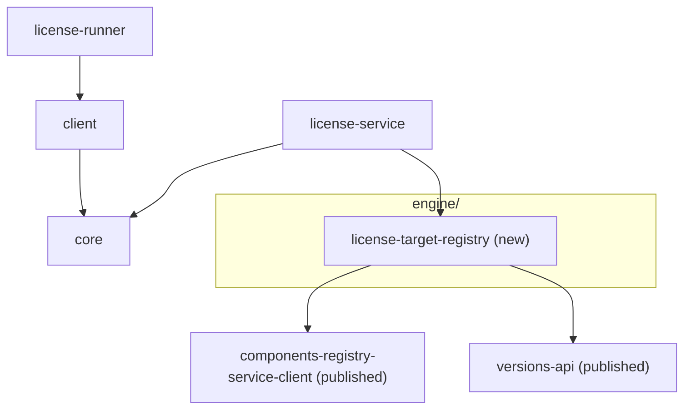

## Context

- `LicenseReportServiceImpl.start` registers every request as `RUNNING` and hands `component` and `version` to `LicenseReportGenerator` on a background thread. `EmptyLicenseReportGenerator` answers every version with an empty summary.
- Nothing checks the request against the components registry, so a typo, an excluded component and a real component all end `DONE` and empty.
- The components registry already holds everything needed to describe a component version:
  - `GET rest/api/2/components/{c}/versions/{v}` (`DetailedComponent`): build system, labels, `archived`, `distribution` (`external`, `GAV`, `docker`), and the version's forms (`detailedComponentVersion.buildVersion`). It answers `404` for an unknown component, or a version outside every configured range.
  - `GET rest/api/2/components/{c}/maven-artifacts`: group and artifact patterns keyed by version range.
  - `GET rest/api/2/common/version-names`: the names `versions-api` needs to parse those ranges.
- The license scan (later) needs a typed description of what a version releases before it opens anything. The component diagram calls that description the license target.

## Worked example

An illustrative component `sample-app`, version `1.4.12` (the values are made up; the shapes are the registry's):

1. `GET …/components/sample-app/versions/1.4.12` returns:
   - `buildSystem: GRADLE`, `archived: false`, `labels: [java]`;
   - `distribution: {external: true, GAV: "org.example.sample:sample-app:zip,org.example.sample:sample-app-config:zip:config", docker: "sample/sample-app"}`;
   - `detailedComponentVersion.buildVersion.version: 1.4.12-0034`.
2. Exclusion rules, in order: not archived, external, not WHISKEY, not flagged `testComponent`, name does not start with `doc_`/`doc-`, not on the configured list. Not excluded.
3. `GET …/components/sample-app/maven-artifacts` returns `{"[1.0,)": {groupPattern: "org.example.sample", artifactPattern: "sample-.*"}, "(,1.0)": {…}}`. Only `[1.0,)` holds `1.4.12`.
4. The license target:
   - component version `sample-app:1.4.12`; artifact versions `[1.4.12, 1.4.12-0034]`;
   - build system `GRADLE`, labels `[java]`;
   - declared artifacts:
     - `MavenArtifact(org.example.sample, sample-app, zip)`;
     - `MavenArtifact(org.example.sample, sample-app-config, zip, classifier = config)`;
     - `DockerImage(sample/sample-app, tag = null)`;
   - artifact patterns: `ArtifactPattern(groups = [org.example.sample], artifacts = [sample-.*])`.

For `doc_user_guide:2.0` step 1 is the only call: the name rule matches, and the result is `Excluded("Documentation component")`.

## Goals / Non-Goals

**Goals:**
- One module answers "what does this component version release, or why is it excluded", reading only the components registry.
- A wrong request fails at `POST`, before any background work.
- Exclusion reasons a component owner can read and act on.

**Non-Goals:**
- Finding concrete files in Artifactory, or matching patterns against build output: the license scan's job.
- `DEB` and `RPM` fields: the license scan does not cover OS packages.
- Showing the license target to callers: it is an internal input; the wire contract stays as it is.
- Caching registry answers: stateless for now.

## Modules



| Module | Owns | May depend on | Must never depend on |
| --- | --- | --- | --- |
| `engine/target-registry` (`:license-target-registry`) | The license target model, the exclusion rules, the components registry adapter | components registry client, `versions-api` | `core`, `server`, Spring |

## Decisions

### 1. A module of its own, reading only the components registry

- `engine/target-registry/` (project `:license-target-registry`) owns resolving a component version into a license target or an exclusion.
- It never imports `core`: the target is richer than anything on the wire, and a wire change must not ripple into it.
- It never imports Spring: `server` builds it from configuration, the way it builds the store.
- Its only I/O is the components registry. Release management, Artifactory and Xray stay out, so the module stays small and its contract stays "what the registry declares".
- It sits under `engine/`, the folder for the modules that produce a report. The license registry and the Xray/Artifactory scan join it later, each its own Gradle project reading only its own systems.

### 2. Pure description, thin adapter

- `LicenseTargetDescriber` is pure: registry facts in, `TargetResolution` out. It holds the exclusion rules, the parsing of `GAV` and `docker` fields, and the range selection of Maven artifact patterns.
- `RegistryLicenseTargetResolver` is the adapter: it fetches from the registry, pushes the facts into the describer, and translates registry errors.
- The describer is tested without mocks or HTTP; the adapter is tested once against a stub HTTP server, which also proves the published client works on this classpath.

```kotlin
interface LicenseTargetResolver {
    /** @throws ComponentVersionNotFoundException @throws ComponentsRegistryUnavailableException */
    fun resolve(component: String, version: String): TargetResolution
}

sealed interface TargetResolution {
    data class Resolved(val target: LicenseTarget) : TargetResolution
    data class Excluded(val componentVersion: ComponentVersion, val reason: String) : TargetResolution
}

data class LicenseTarget(
    val componentVersion: ComponentVersion,
    val artifactVersions: List<String>,   // the version as requested, then the build version when it differs
    val buildSystem: String,
    val labels: Set<String>,
    val distribution: DistributionSpec,
)

data class DistributionSpec(
    val declared: List<DeclaredArtifact>,
    val patterns: List<ArtifactPattern>,
)

sealed interface DeclaredArtifact {
    data class MavenArtifact(val groupId: String, val artifactId: String, val extension: String, val classifier: String?) : DeclaredArtifact
    data class DockerImage(val image: String, val tag: String?) : DeclaredArtifact
    data class Unsupported(val entry: String, val reason: String) : DeclaredArtifact
}

data class ArtifactPattern(val groups: List<String>, val artifacts: List<String>)
```

### 3. Exclusion is a result, not-found and unreachable are exceptions

- `Excluded` is a normal answer the caller acts on, so it is a `TargetResolution` case.
- An unknown component version and an unreachable registry (no answer, a `5xx`, or a `425` while it loads its repository) mean no answer exists, so they are the module's own exceptions: `ComponentVersionNotFoundException`, `ComponentsRegistryUnavailableException`.
- `server` maps them to `core`'s `NotFoundException` (`404`) and a new `ServiceUnavailableException` (`503`).

### 4. Exclusion rules: fixed order, first match wins, cheapest call first

- Order: archived, internal (`distribution.external == false`), build system `WHISKEY`, the registry's `testComponent` flag, name starts with `doc_`/`doc-` (any case), configured list.
- The registry sets `testComponent` from its own configured name patterns, so the registry stays the one place that decides what a test component is; a `test-component` label alone does not exclude.
- All six read only the first registry call, so an excluded component costs one call; `maven-artifacts` and `version-names` are fetched only for a component that is not excluded.
- Each rule gives one fixed reason, so the same component always reads the same way: `Archived component`, `Internal component: its distribution is not external`, `Built with WHISKEY`, `Test component`, `Documentation component`, or the configured entry's own reason.
- The configured list is passed in as plain data (`List<ConfiguredExclusion(components, reason)>`): one reason covers many components, so it is written once. Matching is exact on the component id.

### 5. The published components registry client

- Uses `org.octopusden.octopus.infrastructure:components-registry-service-client` `3.2.0`, as `octopus-dms-service` and `octopus-teamcity-automation` do. Its DTOs follow the registry's wire format without us keeping a copy.
- It brings Jackson 2 and Feign 12, beside the service's Jackson 3 and Feign 13. Jackson 2 and 3 live in different packages; Feign resolves to 13 where both meet (the server's test classpath). The adapter test covers the client on that classpath.
- The module compiles against `feign-core` `12.2` only (`compileOnly`), to tell an unreachable registry from other failures; at runtime Feign comes with the client, so production carries one Feign version.
- Rejected: a hand-rolled Feign interface for the three endpoints. It would keep one stack, but duplicate the registry's DTOs, which would then drift silently.

### 6. Range selection with `versions-api`, patterns kept as strings

- A `maven-artifacts` key is a version range in the registry's own syntax; `VersionRangeFactory` from `org.octopusden.octopus.releng:versions-api`, built from the registry's `version-names`, parses it exactly as the registry does.
- Every entry whose range holds the requested version is kept; comma-separated group and artifact patterns are split and trimmed.
- Patterns stay strings in the target. Compiling and matching them against build output is the license scan's job, so a pattern the registry stored but cannot compile surfaces there, against the file it failed on.

### 7. `GAV` and `docker` parsing never fails the resolution

- `GAV`: comma-separated `group:artifact:extension[:classifier]`. An entry with another number of parts, or a `file:`/`http:`/`https:` URI, becomes `Unsupported` with the reason.
- `docker`: comma-separated `image[:tag]`; the tag is split on the last `:` after the last `/`, so a registry host with a port stays part of the image.
- Keeping a bad entry as `Unsupported` lets the license scan report it against the version, instead of failing the whole start over one entry.

### 8. Resolution happens in `start`, on the request thread

- `LicenseReportServiceImpl.start` calls the resolver before it registers a report:
  - `Resolved`: register `RUNNING`, generate in the background with the target;
  - `Excluded`: register the report already `EXCLUDED`, with the reason and no files; nothing goes to the executor;
  - an exception: nothing is registered.
- `LicenseReportGenerator.generate` takes a `LicenseTarget` instead of `component` and `version`. `EmptyLicenseReportGenerator` ignores it until the scan lands.

### 9. Configuration

- `license-service.components-registry-url`: required; a missing value fails startup.
- `license-service.exclusions`: a list of `{components, reason}`, `components` a comma-separated list of component ids. It lives in Spring Cloud Config only, never in this repository: the component names are internal, and the repository is public.

### 10. A registry outage is a metric, not a health indicator

- Every resolution is counted as `license.target.resolutions` with tag `outcome`: `resolved`, `excluded`, `not_found` or `unavailable`. Prometheus scrapes it as `license_target_resolutions_total`.
- No health indicator for the registry. It is called per request and shared by every pod: in readiness it would turn every pod unready at once, blocking even `GET` of running reports; in liveness it would restart pods that cannot fix it.
- An outage already answers `503` per request; the `unavailable` count is what an alert watches.
- The counter lives in `server`, not in `license-target-registry`: the module reads one system and knows nothing of Micrometer.

## Risks / Trade-offs

- **Two Feign versions meet in the server's test classpath.** The client is built for Feign 12 and runs on 13 there. Accepted: the adapter test exercises it end to end; the published client upgrading its Feign is a version bump here.
- **The start request waits on the registry.** Up to three calls, normally a few hundred milliseconds. Accepted for a clear `404`; caching can come with the portal.
- **Exclusion by name prefix.** A component named `doc-…` that is not documentation would be excluded. Accepted: it is the prototype's rule; a false match is fixed by renaming or by a configured override later.
- **The configured list is the only way to exclude a component that still applies the old plugins.** Forgetting to add one gives that component a second, competing set of license files. Accepted for now; the rollout issue lists those components.
