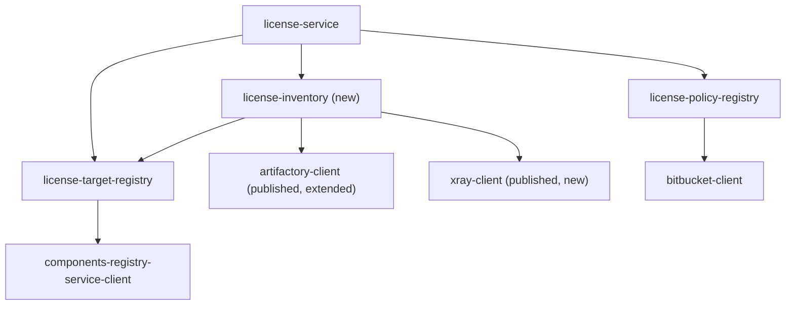

## Context

- `LicenseReportServiceImpl` resolves a `LicenseTarget` (`license-target-registry`) and takes the current `LicensePolicy` (`license-policy-registry`), then calls `LicenseReportGenerator.generate(target, policy)` on a background thread. `EmptyLicenseReportGenerator` returns an empty summary.
- `LicenseTarget` already holds what the scan starts from: component version, artifact versions (version, then build version), labels, build system, declared artifacts (`MavenArtifact`, `DockerImage`, `Unsupported`) and Maven artifact patterns as strings.
- The algorithm lives in `cdd-sandbox/test-license/xray_licence_scan.py`: `analyse()` (stages 4–7 and 10), `scan()` and `collect()` (stages 8–9), then verdicts (stage 11) and `assess_confidence()` (stage 12). Run 14 scanned 559 external components; its `components/<c>.json` is the baseline.
- This change ports `analyse()` up to and including stage 10 (checksum naming, license fill). Everything from `is_internal`/`verdict` onward is the next change.
- `octopus-external-systems-client` has `artifactory-client` (build-info, AQL, download) but no Xray client, and its AQL item lacks the checksums the scan matches on.

## Worked example

An illustrative explicit external component `sample-portal`, version `2.4.0`, build version `2.4.0-118` (names made up; shapes are real):

1. Target: declared `org.example.portal:sample-portal:zip` and docker `sample/portal`; pattern `groups=[org\.example\.portal] artifacts=[sample-.*]`.
2. Convention builds (Decision 4): `sample-portal_ee/2.4.0` missing, `sample-portal_ee/2.4.0-118` found; `sample-portal_ee_docker/2.4.0-118` found.
3. Listing (Decision 5), from `sample-portal_ee`, module `org.example.portal:sample-portal:2.4.0-118`:

   | Published file | Entry | Selection | Status before reading |
   | --- | --- | --- | --- |
   | `sample-portal-2.4.0-118.zip` | `org.example.portal:sample-portal:zip` | `DECLARED`, `PATTERN` | located by sha1 |
   | `sample-portal-2.4.0-118.pom` | `org.example.portal:sample-portal:pom` | `PATTERN` | `METADATA` |
   | `sample-portal-config-2.4.0-118.yaml` | `org.example.portal:sample-portal-config:yaml` | `PATTERN` | located by sha1 |
   | `helper-tool-2.4.0-118.jar` | `org.example.portal:helper-tool:jar` | none | `NOT_SELECTED` |

   From `sample-portal_ee_docker`: `sample/portal/2.4.0-118/manifest.json` gives `sample/portal:2.4.0-118`, `DOCKER_BUILD`, declared (image name matches).
4. Reading (Decision 6):
   - the zip: Xray indexed it and lists `gav://org.springframework:spring-core:6.1.4` (Apache-2.0) and `generic://sha256:ab12…/netty-common-4.1.107.Final.jar`; the build's producing module records `com.fasterxml.jackson.core:jackson-databind:2.17.0` (`runtime`), `org.junit.jupiter:junit-jupiter:5.10.2` (`test`, dropped) and `org.example.portal:portal-plugins:2.4.0-118` type `zip` under `modpackages`, which Xray's scan of the zip lists, so it ships;
   - `portal-plugins` is located by coordinates, its build by `build.name`; Xray finds libraries in it, so its own SBOM and dependencies are read too, and counted for the outer zip;
   - the yaml: Xray did not index it and `yaml` is a text type: `PLAIN_FILE`, nothing read;
   - the image: read from Xray and from the docker build.
5. Naming (Decision 8): `generic://sha256:ab12…` is stored in `maven-central-cache` at `io/netty/netty-common/4.1.107.Final/netty-common-4.1.107.Final.jar`, so it becomes `pkg:maven/io.netty/netty-common@4.1.107.Final` with evidence `BINARY_SCAN`, `CHECKSUM_MATCH`; its Xray licenses are dropped (Decision 10.6).
6. License fill (Decision 9): `jackson-databind` and `netty-common` have no license yet; one Xray call returns `Apache-2.0` for both.
7. Inventory: 6 files (2 read, 1 plain, 1 metadata, 1 not selected, 1 image), the packages with licenses, evidence and the files they were found in, and the findings.

## Goals / Non-Goals

**Goals:**
- For the same Artifactory and Xray state, the inventory equals the prototype's rows before stage 11: same files with the same statuses, same packages with the same raw licenses, sources and files.
- Every step of the algorithm has one owning class; each rule lives in exactly one place.
- The decisions (which file, which scope, which status) are pure and tested without I/O; the I/O sits behind four narrow ports with in-memory fakes in tests.
- The clients the scan needs are published, typed clients in `octopus-external-systems-client`.

**Non-Goals:**
- Judging packages (ours, OS packages, verdicts) and grading trust: the next change. The inventory carries every fact they need.
- Improving the algorithm. Known gaps (APK contents, C/C++ compiled in) stay gaps; changes come after parity is shown.
- Speed beyond the prototype's: one report scans its files one after another, as the prototype did per component; reports run in parallel up to `generation-threads`.

## Modules



| Module | Owns | May depend on | Must never depend on |
| --- | --- | --- | --- |
| `engine/inventory` (`:license-inventory`) | Finding every released file of a license target and every library in it, with the licenses its sources name | `license-target-registry` (model only), `artifactory-client`, `xray-client` | `core`, `server`, Spring, `license-policy-registry` |

`license-policy-registry` stays out: the inventory names licenses as sources give them; judging them is evaluation.

## Classes and their responsibilities

Package `org.octopusden.octopus.license.inventory`. `impl/` is `internal` except the scanner's public constructor. Four layers, dependencies pointing down only:

```
LicenseInventoryScanner (interface)            ← server
└─ impl/JfrogLicenseInventoryScanner           orchestration only: A → B → C → assemble
   ├─ impl/listing/   step A: which files      ReleasedFileLister, BuildLocator          (I/O through ports)
   │                                           ConventionBuilds, CandidateExtractor,
   │                                           PublishedFileName, CandidateSelector,
   │                                           ArtifactPatternMatcher                    (pure)
   ├─ impl/reading/   step B: what is inside   FileContentReader, SbomReader             (I/O through ports)
   │                                           FileStatusJudge, BuildDependencyReader,
   │                                           ShippingScopes, CycloneDxParser           (pure)
   ├─ impl/naming/    step C: names, licenses  ChecksumNamer, LicenseFiller              (I/O through ports)
   │                                           PackageTable                              (pure)
   ├─ impl/Ownership                           which groups, file names and repositories are ours (pure)
   ├─ impl/port/      BuildRecords, ArtifactStore, BinaryScanner, LicenseDatabase       (interfaces + their data)
   └─ impl/adapter/   ArtifactoryBuildRecords, ArtifactoryArtifactStore, XrayBinaryScanner,
                      XrayLicenseDatabase, XrayComponentIds, RepositoryPreference, Memoized ports
```

| Class | Kind | One responsibility | Prototype |
| --- | --- | --- | --- |
| `LicenseInventoryScanner` | interface | The contract: a target in, its inventory out | `analyse()` up to stage 10 |
| `JfrogLicenseInventoryScanner` | orchestrator | Builds one scan's memoized ports, runs A, B per file, C, assembles the inventory. Decides nothing itself | `analyse()` body |
| `ConventionBuilds` | pure | The convention build names of a target | `convention` |
| `ReleasedFileLister` | I/O | Step A: the convention route and the declared-leftover route, giving every listed file with its stored file and build | `analyse()` §1–2 |
| `CandidateExtractor` | pure | A build record's published files as candidates: docker images from `manifest.json`, Maven entries from module id and file name | loop over `module.artifacts` |
| `PublishedFileName` | pure | `artifactId-version[-classifier].ext` split into artifact id, classifier, extension | `split_artifact_name` |
| `CandidateSelector` | pure | Why a candidate is read (`DECLARED`, `PATTERN`, `DOCKER_BUILD`), or why not (`NOT_SELECTED`, `METADATA`) | `selected_by`, metadata skip |
| `ArtifactPatternMatcher` | pure | Full match of group and artifact against the target's patterns | `matches_patterns` |
| `BuildLocator` | I/O | The build of a stored file: properties, then checksum. Shared by the declared-leftover route and nested archives | `find_build` |
| `FileContentReader` | I/O | Step B for one located file: status, then every source, then nested archives, recursively | `scan()` + `collect()` |
| `FileStatusJudge` | pure | The status of a located file from "Xray indexed it", "build known", kind and extension | status logic in `scan()` |
| `BuildDependencyReader` | pure | From a build record and the file: npm production packages, the producing module's shipped packages, our nested archives, findings | `npm_dependencies`, dependency loop |
| `ShippingScopes` | pure | Whether a build-info scope ships: runtime scopes, Android release/embed, never test or debug | `is_runtime_scope`, `NOT_SHIPPED_SCOPE` |
| `SbomReader` / `CycloneDxParser` | I/O / pure | SBOM files of a build: find, download, parse purls and licenses | `sbom_components` |
| `PackageTable` | pure | The merged rows: one per package id, licenses, evidence and files joined; renaming a row | `rows` |
| `ChecksumNamer` | I/O | Renames checksum-only packages that are not ours to the Maven coordinates their checksum is stored under | `maven_purl_by_checksum` loop |
| `LicenseFiller` | I/O | Fills licenses of packages that have none, from the license database | `xray_component_licences` loop |
| `Ownership` | pure | Is a Maven group ours, a file name ours, a repository ours | `INTERNAL_GROUPS`, `is_internal` prefix, `rnd-*local` |
| `BuildRecords` | port | Build-info by name and number; builds by a published file's sha1 | `build_info`, AQL `builds.find` |
| `ArtifactStore` | port | Stored files by sha1, by path, by sha256; a file's bytes | `file_by_sha1`, `resolve_gav`, `files_by_sha256`, GET |
| `BinaryScanner` | port | What a binary scanner recognises in a stored file, or "not indexed" | `xray_scan` |
| `LicenseDatabase` | port | Licenses of packages by coordinates | `xray_component_licences` |
| `XrayComponentIds` | pure | Xray component id ↔ `PackageId`, both directions | `normalise`, `xray_component_id` |
| `RepositoryPreference` | pure | Which stored copy wins: release local, then local, then any, then by name | `pick` |

Shared rules, one owner each (the reason these are extracted):

- **Locating a build**: `BuildLocator`, used by declared leftovers (stage 7) and nested archives (9.4). Both must find builds the same way.
- **Which copy of a file**: `RepositoryPreference`, inside `ArtifactStore`, for sha1 and path lookups.
- **What is ours**: `Ownership`, used by `BuildDependencyReader` (which archives to follow) and `ChecksumNamer` (which files not to rename). The next change's evaluation uses the same class.
- **Xray ids**: `XrayComponentIds` holds both directions, so a package found by the scanner is asked about by the same id.

### Skeletons

```kotlin
interface LicenseInventoryScanner {
    /** @throws InventorySourceUnavailableException Artifactory or Xray could not be asked. */
    fun scan(target: LicenseTarget): LicenseInventory
}

data class LicenseInventory(
    val componentVersion: ComponentVersion,
    val builds: List<BuildRef>,              // the convention builds found
    val files: List<ReleasedFile>,           // every listed file, read or not, in listing order
    val packages: List<FoundPackage>,        // merged across files, sorted by id
    val findings: List<Finding>,             // distinct, in the order found
)

data class ReleasedFile(
    val entry: String,                       // g:a:ext[:classifier], image:tag, or the registry entry
    val kind: FileKind,                      // MAVEN, DOCKER, FILE_SHARE
    val declared: Boolean,
    val selectedBy: Set<SelectionReason>,    // DECLARED, PATTERN, DOCKER_BUILD; empty when NOT_SELECTED
    val path: String?,                       // repo/path/name in Artifactory
    val build: BuildRef?,
    val buildFoundBy: BuildLookup?,          // CONVENTION, PROPERTIES, CHECKSUM
    val buildAgent: String?,
    val status: FileStatus,
    val evidence: Set<Evidence>,             // READ only: BINARY_SCAN when Xray indexed it, BUILD_RECORD when its build is known
)

enum class FileStatus { NOT_SELECTED, METADATA, NOT_FOUND, UNSUPPORTED, PLAIN_FILE, NOT_READABLE, READ }

data class FoundPackage(
    val id: PackageId,
    val licenses: Set<String>,               // as sources name them; empty when none did
    val evidence: Set<Evidence>,             // BINARY_SCAN, SBOM, BUILD_RECORD, CHECKSUM_MATCH
    val foundIn: Set<String>,                // entries of the released files
)

sealed interface PackageId {
    data class Purl(val type: String, val name: String, val version: String) : PackageId   // pkg:type/name@version
    data class ChecksumOnly(val sha256: String, val fileName: String) : PackageId           // generic://sha256:…/name
    data class Unrecognized(val raw: String) : PackageId                                     // kept verbatim
}

data class Finding(val code: FindingCode, val subject: String, val detail: String)

enum class FindingCode {
    NOT_SCANNABLE, NO_PRODUCING_MODULE, LOCAL_FILE_DEPENDENCY, UNRESOLVED_INTERNAL_ARCHIVE,
    NO_LIBRARIES_IN_FILE, BUILD_NAME_DIFFERS, ARTIFACT_NOT_FOUND, UNSUPPORTED_DISTRIBUTION_ENTRY,
    NOT_IN_XRAY, NO_BUILD_INFO, NO_DISTRIBUTION,
}

data class OwnershipRules(val internalGroups: List<String>, val ownRepositoryPrefixes: List<String>)

internal interface BuildRecords {
    fun find(name: String, number: String): BuildRecord?          // null: missing or unreadable
    fun findByPublishedSha1(sha1: String): List<BuildRef>
}

internal interface ArtifactStore {
    fun bySha1(sha1: String): StoredFile?                           // preferred copy
    fun byPath(path: String, name: String): StoredFile?             // preferred copy
    fun bySha256(sha256: String): List<StoredFile>                  // every copy
    fun read(file: StoredFile): ByteArray
}

internal interface BinaryScanner {
    fun scan(file: StoredFile): Map<PackageId, Set<String>>?        // null: not indexed
}

internal interface LicenseDatabase {
    fun licensesOf(packages: List<PackageId.Purl>): Map<PackageId.Purl, Set<String>>
}
```

## Decisions

### 1. One module, `license-inventory`, reading Artifactory and Xray only

- `engine/inventory/` (`:license-inventory`) owns phase 2 of the component diagram. It depends on `license-target-registry` for `LicenseTarget` only, never on its registry adapter.
- Artifactory and Xray are one JFrog platform with one URL and one token, so one module reads both. Splitting them would put the nested-archive rule (which needs both) across a module boundary.
- `license-policy-registry` stays out: the inventory names licenses as found; evaluation judges them.

### 2. Pure decisions, I/O orchestrators, four ports

- The algorithm needs lookups in the middle of its decisions (a nested archive's build, an SBOM's bytes), so a fully pushed pure core would mean pre-fetching unknown depths. Instead:
  - every decision (selection, status, scopes, dependencies, merging, ids, ownership, preference) is a pure class tested with plain data;
  - four orchestrators (`ReleasedFileLister`, `FileContentReader`, `ChecksumNamer`, `LicenseFiller`) sequence those decisions and call the ports;
  - the ports are internal interfaces; the orchestrators are tested against in-memory fakes, not mocks.
- Only `impl/adapter/` imports the client packages, so a client DTO never reaches a decision.
- Rejected: one `PackageSource` interface per source (the earlier component diagram). The prototype's sources are not independent: SBOM and build-info are read only with a build, the ship proof and the data-archive rule read Xray's result. One reader sequencing them states that order once.

### 3. The inventory is the prototype's rows, typed

- `ReleasedFile` is a row of `artifacts.csv`; `FoundPackage` is a row of `components.csv` before stage 11 (`purl`, `xray_licences`, `sources`, `artifacts`).
- Statuses use neutral words (component diagram, its D-001): `READ` with `evidence` replaces `CHECKED` (`BINARY_SCAN` present) and `BUILD_INFO_ONLY` (absent); `NOT_READABLE` replaces `NOT_IN_XRAY`. The parity check maps them back.
- `PackageId` is typed but renders exactly as the prototype's purl strings. A purl whose parsed form would not render back to the same string is kept `Unrecognized`, verbatim, so parsing can never change an id.
- Findings keep the prototype's codes for notes and violations, so the next change grades from the same codes.

### 4. Convention builds

- Names: `{component}_{e|i}e` (first letter from `explicit`), then the same with `_docker`. The second letter is always `e`: an internal component is excluded before the scan.
- Each name is looked up at each artifact version in order; the first that exists is the build. Missing or unreadable build-info is "no build", never an error.
- `LicenseTarget` gains `explicit`, read from the same registry call (`distribution.explicit`).

### 5. Listing (step A)

- Docker: an artifact of a `docker` module, or any artifact whose path ends in `manifest.json`, is an image only when its name is `manifest.json` (not `list.manifest.json`); other files of those modules are not listed. The entry is the path's folder as `image:tag`. Always selected (`DOCKER_BUILD`); declared when the entry or its image name equals a declared image's name, and that declared image is then no leftover. Located by its `manifest.json` path at its own tag; missing is `NOT_FOUND`.
- Maven: group from the module id; artifact id, classifier and extension from the file name (`PublishedFileName`), the artifact id falling back to the module's when the file name lacks `-{version}`. Entry `g:a:ext[:classifier]`.
- Selection: declared (exact entry) and/or pattern (group and artifact each fully match one pattern of the same entry); neither is `NOT_SELECTED`. Not declared, and extension in `pom module md5 sha1 sha256 asc` or classifier in `sources javadoc tests test-sources test-fixtures`: `METADATA`.
- A selected file is located by sha1; missing is `NOT_FOUND` with finding `ARTIFACT_NOT_FOUND`.
- Declared leftovers (Maven entries and images no convention file matched): `Unsupported` is `UNSUPPORTED` with finding `UNSUPPORTED_DISTRIBUTION_ENTRY`; Maven by path `g/a/v/a-v[-c].ext` at each artifact version; an image at its tag, else at each artifact version. Its build via `BuildLocator`; a build not named by convention is finding `BUILD_NAME_DIFFERS`.
- Nothing selected at all: finding `NO_DISTRIBUTION`, and steps B and C are skipped.

### 6. Reading (step B)

- `FileStatusJudge`, in this order: not indexed, Maven, text extension (`yaml yml xml json txt properties sql sh bat md pdf html csv`) → `PLAIN_FILE` with finding `NOT_SCANNABLE`, nothing read even with a build; not indexed → finding `NOT_IN_XRAY`; no build → finding `NO_BUILD_INFO`; both missing → `NOT_READABLE`; otherwise `READ`.
- `FileContentReader`, for a `READ` file, as `collect()`:
  1. Xray's packages, evidence `BINARY_SCAN`;
  2. no build: stop;
  3. a nested archive (depth > 0) whose Xray list has no library other than itself and docker layers: finding `NO_LIBRARIES_IN_FILE`, stop;
  4. every SBOM of every module of the build, evidence `SBOM`;
  5. production dependencies of every `npm` module, evidence `BUILD_RECORD`;
  6. the producing module (an artifact with the file's sha1 or name); none: finding `NO_PRODUCING_MODULE`, stop;
  7. its dependencies (Decision 7).
- Evidence for nested packages is their own; the files they are found in are the outer released file's.

### 7. Shipped dependencies and our own archives

- A dependency is read when any of its scopes ships (`compile`, `runtime`, `runtimeClasspath`, `embed`; or matching `Release\w*RuntimeClasspath$|Embed$` with no `test`/`debug` in it), or when it is our own archive that ships by proof.
- Our own archive: type `zip tar tgz gz war ear`, group starting with an internal group. Shipped by proof: no scope mentions `test` or `debug`, and Xray's scan of the current file lists exactly `pkg:maven/g/a@v`.
- `Gradle API`, `Local Groovy`, `Gradle TestKit`: skipped. An id without three non-empty coordinate parts: finding `LOCAL_FILE_DEPENDENCY`.
- Our own archive is followed, never listed as a package: located by path `g/a/v/a-v.{type}`, else by its sha1 (coordinates first: a dependency resolved by several configurations can carry its sources' checksum); its build via `BuildLocator`; no file or no build: finding `UNRESOLVED_INTERNAL_ARCHIVE`. Each `(build name, number, dependency id)` is followed once per released file; deeper than 10 stops.
- Any other dependency is `pkg:maven/g/a@v`, evidence `BUILD_RECORD`, no license.

### 8. Checksum naming (step C)

- After every file is read, each `ChecksumOnly` package that is not ours (file name starts with an internal group plus `.`, or a copy with that sha256 sits in an own repository) is looked up by sha256 across Artifactory.
- The first copy whose path is `…/{a}/{v}/` and whose name starts with `{a}-{v}` renames it to `pkg:maven/{group from path}/{a}@{v}`, evidence plus `CHECKSUM_MATCH`, merged into an existing row of that id.
- Found nowhere: it stays `ChecksumOnly`.

### 9. License fill (step C)

- Packages with no license, of type `maven` or `npm`, are asked from the license database in batches of 100, in id order. A batch that fails leaves its packages without a license and does not fail the scan.

### 10. Ported as it is, odd or not

Kept because the prototype's results are the baseline; each may be revisited after parity is shown:

1. A docker image is always read, declared or not.
2. Patterns and declared entries both select; a pattern-only pom is still `METADATA`.
3. A plain text file is not read from its build either.
4. SBOMs and npm dependencies of the whole build are counted for every file of that build.
5. A nested archive's packages count for the outer released file.
6. Renaming a checksum-only package drops the licenses Xray gave the unnamed file; the fill step asks again by coordinates.
7. Our own Maven packages and the file's own coordinates stay in the inventory; evaluation calls them internal.

### 11. Deliberate differences from the prototype

| Difference | Why | Can affect |
| --- | --- | --- |
| Pattern ranges selected with `versions-api` (already in the target) | The registry's own parser; the prototype's range regex is an approximation | A component whose range bounds use registry version formats |
| Docker tag split on the last `:` after the last `/` (already in the target) | A registry host with a port stays in the image name | Declared images with `host:port`; none in run 14 |
| Patterns compiled as Java regexes | The registry stores Java regexes; the prototype patched one Python incompatibility | None known |
| Waits for Xray to finish scanning (Decision 12) | A new RC is scanned seconds before the report | None on already scanned files |
| Caches live for one report, not one batch run | A service has no batch | None: one report sees one state |

### 12. Waiting for Xray

- Before reading a file's scan, `XrayBinaryScanner` asks `POST /xray/api/v1/artifact/status` and reads `details.sca.status` (the license scan; the overall status also covers security scans the service does not need).
- Pending (`PENDING`, `SCANNING`): poll every `xray-scan-poll-interval` (10 s), up to `xray-scan-timeout` (5 min) per report.
- `DONE`: read the summary.
- Anything else (`NOT_SUPPORTED`, `NOT_SCANNED`, `FAILED`), an error answer, or still pending at the timeout: "not indexed", exactly as the prototype treats a file Xray has no scan of. The file is then read from its build only, and finding `NOT_IN_XRAY` names it.
- The wait lives in the adapter: the algorithm only sees "indexed" or "not indexed".
- Checked against our Xray (3.150.37): a released zip answers `DONE`, a pom `NOT_SUPPORTED`, a missing file an `error` body; the artifact summary answers a pom with an `errors` entry ("not indexed/cached"); the component summary answers ids without their scheme (`com.google.guava:guava:32.1.2-jre`, `react:18.2.0`).

### 13. Failures

- Artifactory or Xray unreachable, `5xx` after retries, or `401`/`403`: `InventorySourceUnavailableException(system)`; the scan fails, as the prototype's component ended in `ERROR`.
- Tolerated as the prototype tolerates them: build-info missing or unreadable (no build); an SBOM that cannot be downloaded or parsed (skipped); a license batch that fails (no licenses); Xray answering with an error for a path (not indexed).
- Retries: the clients' default retryer, as the prototype retried each call 3 times.

### 14. Clients in octopus-external-systems-client

- New `xray-client` (`org.octopusden.octopus.infrastructure.xray.client`), on the same `ClientParametersProvider` and Feign stack as `artifactory-client`, base URL the JFrog platform URL:
  - `POST xray/api/v1/artifact/status` `{repo, path}` → `overall` and `details.sca` status (`DONE`, `PENDING`, `SCANNING`, `NOT_SUPPORTED`, `NOT_SCANNED`, `FAILED`);
  - `POST xray/api/v1/summary/artifact` `{paths}` → artifacts with licenses and their components; errors per path;
  - `POST xray/api/v1/summary/component` `{component_details: [{component_id}]}` → licenses per component.
- `artifactory-client`, additive only:
  - `AqlItem.actualSha1` (`actual_sha1`) and `AqlItem.sha256`;
  - `Artifact.path` in build-info modules (docker images carry their manifest path there);
  - `searchBuildsByAQL(query)` returning `build.name`, `build.number` rows, since build AQL results are not item-shaped.
- The service pins both versions in `gradle.properties`. Until they are published, the service builds against a local `publishToMavenLocal`.

### 15. No server wiring in this change

- This change and the evaluation change ship to QA and Prod together; they are split only to keep each one reviewable. The server first calls the scanner in the evaluation change, which also maps the result into the report.
- What the server will need, recorded here so the module's public constructor fits it:
  - `jfrog.url` (required) and `jfrog.token` (required, from Vault);
  - `inventory.internal-groups` and `inventory.own-repository-prefixes` (required, from Spring Cloud Config: company names stay out of this public repository);
  - `inventory.xray-scan-timeout` (default 5 min), `inventory.xray-scan-poll-interval` (default 10 s);
  - one `JfrogLicenseInventoryScanner` for every generation thread, as it keeps no state across scans;
  - a counter `license.inventory.scans{outcome}`, no health indicator (per-request dependency, as the components registry).

### 16. Parity check

- A `parityTest` source set in `engine/inventory`, run by `./gradlew :license-inventory:parityTest`, never by `build` or `check`: it needs real Artifactory, Xray and the components registry.
- Input: a prototype output directory (`components/<c>.json`) made from a local run (`xray_licence_scan.py --only …`) just before, so both read the same state; the list of components defaults to all in that directory.
- For each component it resolves the target, scans, projects both sides into one view and diffs:
  - files: entry, kind, declared, selected by, path, build, found by, status (mapped back), read, scanned, no build;
  - packages: id, licenses (`xray_licences`), sources, files;
  - findings: code, subject, detail.
- Output: `build/parity/report.md` with a line per component (`same` or the count of differences) and every difference listed. Done means no difference other than those in Decision 11.

## Risks / Trade-offs

- **Two releases before the service builds.** The clients must be published first. Accepted: they are small, additive and owned by this team.
- **A report holds a generation thread while Xray scans.** Up to 5 minutes per report; with 4 threads, 4 slow scans block the rest, which queue. Accepted for report-only rollout; the timeout and thread count are configuration.
- **A scan still pending after 5 minutes gives a weaker list, not a failure.** The file is read from its build only, as the prototype reads any file Xray has no scan of; finding `NOT_IN_XRAY` shows it, and grading will lower trust for it. Accepted to match the prototype; a rerun after Xray finishes gives the full list.
- **Parity is measured against a moving target.** Artifactory and Xray change; a stale prototype run shows false differences. Mitigated by running the prototype locally right before the parity check.
- **Odd rules are ported on purpose (Decision 10).** Some will turn out wrong; fixing them after parity keeps each change explainable against the baseline.
