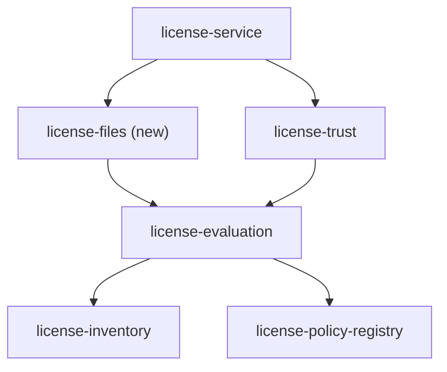

## Context

**What exists today**

- `LicenseAssessment` (`:license-evaluation`) holds:
  - the inventory: released files with status, kind and Artifactory path; libraries with their package id and `foundIn` (released file entries);
  - every counted library with its verdict and its canonical licenses, after any override.
- `LicensePolicy.text(license)` gives a license's text location from `licenses.properties`: `LicenseText.InRegistry(path, content)` or `LicenseText.AtUrl(url)`. Its KDoc already says fetching a URL is the license files' job.
- `EvaluatingLicenseReportGenerator` returns an empty zip; `LicenseReportStore` bounds finished reports by zip bytes only.
- The runner already saves the zip to `--output-dir`.

**What the plugin writes, per Maven module** (the shared parent POM's configuration: `add-third-party` and `download-licenses`, both into `license.output.directory`)

- `THIRD-PARTY.txt` from `third-party-file.ftl`:
  - an empty first line, then `Lists of N third-party dependencies.`;
  - one line per dependency: four spaces, then ` (License)` per license, a space, then `Name (group:artifact:version - url)`;
  - `The project has no dependencies.` when there are none.
- `licenses.xml` from `LicenseSummaryWriter`: `licenseSummary/dependencies/dependency` with `groupId`, `artifactId`, `version`, `licenses/license/{name, url}`.
- One text per license, named by `getLicenseFileName`: `{name, '/' → '_'} - {last path segment of the location}`, `.txt` appended when there is no extension, all lower case. `Apache-2.0=licenses/APACHE-2.0.txt` gives `apache-2.0 - apache-2.0.txt`.

## Worked example

`payments:1.4.0` releases `payments-app-1.4.0.jar` and the image `payments/ui:1.4.0`; both are `READ`.

| Library | Verdict | Licenses | `foundIn` |
| --- | --- | --- | --- |
| `pkg:maven/commons-io/commons-io@2.11.0` | ALLOWED | Apache-2.0 | app jar |
| `pkg:maven/org.slf4j/slf4j-api@1.7.36` | ALLOWED | MIT | app jar, image |
| `pkg:maven/com.example/foo-core@1.0` | UNKNOWN | — | app jar |
| `pkg:npm/react@18.2.0` | ALLOWED | MIT | image |
| `pkg:maven/org.example.own/lib@2.0` | INTERNAL | — | app jar |

The zip:

```
payments-1.4.0-licenses.zip
├── payments-app-1.4.0.jar/
│   ├── THIRD-PARTY.txt
│   ├── licenses.xml
│   ├── apache-2.0 - apache-2.0.txt
│   └── mit - mit.txt
└── payments_ui_1.4.0/
    ├── THIRD-PARTY.txt
    ├── licenses.xml
    └── mit - mit.txt
```

`payments-app-1.4.0.jar/THIRD-PARTY.txt`:

```

Lists of 3 third-party dependencies.
     (Apache-2.0) commons-io (commons-io:commons-io:2.11.0)
     (Unknown license) foo-core (com.example:foo-core:1.0)
     (MIT) slf4j-api (org.slf4j:slf4j-api:1.7.36)
```

The internal library is not listed. `slf4j-api` is in both folders. `foo-core` has no license, so no text; nothing is missing, since there is no license to have a text for.

## Goals / Non-Goals

**Goals:**

- The plugin's three outputs, per released file, for every counted third-party library.
- Writing is pure: assessment, policy and downloaded texts in, files out, tested with plain data.
- A missing text never fails a report; it is listed.
- A build can fail on a violation, per verdict, only when its step asks for it; by default every build stays green.

**Non-Goals:**

- Byte-identical output to the plugin.
- Deciding where the files are published.

## Modules



| Module | Owns | May depend on | Must never depend on |
| --- | --- | --- | --- |
| `engine/files` (`:license-files`) | The license files of each released file: which libraries, in which layout, with which texts | `:license-evaluation` (its model, and through it the inventory's and the policy's) | `core`, `server`, Spring, any client, any I/O, `:license-trust` |

## Classes and their responsibilities

Package `org.octopusden.octopus.license.files`; everything under `impl/` is `internal`.

```
LicenseFilesWriter               public · textsToDownload(assessment, policy) · write(assessment, policy, downloaded)
├─ model/                        public · LicenseFiles, FileFolder, NamedFile, MissingText, MissingTextReason
└─ impl/
   ├─ FolderPlanner              pure · which released files get a folder, its name, its libraries
   ├─ NoticeLine                 pure · one library's name, id and licenses as the plugin writes them
   ├─ ThirdPartyText             pure · THIRD-PARTY.txt of one folder
   ├─ LicensesXml                pure · licenses.xml of one folder
   └─ LicenseTextFiles           pure · the text files of one folder, and the missing ones
```

### Skeletons

```kotlin
class LicenseFilesWriter {
    /** The URLs of the texts the assessment's licenses need, so the server can download them first. */
    fun textsToDownload(assessment: LicenseAssessment, policy: LicensePolicy): Set<String>

    /** [downloaded] is URL to bytes, for the downloads that succeeded only. */
    fun write(assessment: LicenseAssessment, policy: LicensePolicy, downloaded: Map<String, ByteArray>): LicenseFiles
}

data class LicenseFiles(val folders: List<FileFolder>, val missingTexts: List<MissingText>)
data class FileFolder(val name: String, val releasedFile: String, val files: List<NamedFile>)
class NamedFile(val name: String, val content: ByteArray)
data class MissingText(val license: String, val reason: MissingTextReason, val url: String?)
enum class MissingTextReason { NO_REGISTRY_ENTRY, DOWNLOAD_FAILED }
```

In `server`:

```kotlin
class LicenseTextDownloader(timeout: Duration) {        // the only I/O; caches successful downloads by URL
    fun download(urls: Set<String>): Map<String, ByteArray>
}
object LicenseFilesZip { fun zip(files: LicenseFiles): ByteArray }
```

## Decisions

### 1. A pure module, texts pushed in

- `:license-files` reads nothing. The server asks it which URLs it needs, downloads them, and pushes the bytes back in.
- Push, not a "fetch a text" port: the set of URLs is known before writing, so the writer never needs a lookup mid-decision.
- Zipping is in `server` (`LicenseFilesZip`): the zip is the wire's shape, the module's result is folders and files.

### 2. One folder per released file that was read

- A selected released file that was not read (`NOT_READABLE`, `NOT_FOUND`, `UNSUPPORTED`) has no folder; `NOT-CHECKED.txt` at the top of the zip lists each with why, so a reader can tell "not checked" from "nothing found". A plain file holds no libraries, so it was checked. No folder takes its name: an archive cannot hold one path as a file and a folder (added on review).

- A folder for every released file with status `READ`, in listing order, even one with no third-party library (`The project has no dependencies.`, as the plugin writes for an empty module).
- No folder for a file not read: it has no libraries, and trust already says why.
- The folder name:
  - a Maven file: the last segment of its Artifactory path (`sample-app-1.4.0.war`);
  - an image: its entry with `/` and `:` replaced by `_` (`payments_ui_1.4.0`), since a manifest's file name says nothing.
  - Two folders with the same name get `-2`, `-3` in listing order; a suffix that another file has as its own name is skipped, so every folder is distinct.
- A library goes into the folder of every entry in its `foundIn`.

### 3. Which libraries: every counted third-party library

- Every `AssessedLibrary` whose verdict is not `INTERNAL`: `ALLOWED`, `NOT_ALLOWED`, `UNKNOWN` and `UNIDENTIFIED`, any ecosystem.
- The plugin listed only Maven dependencies with licenses; the files are a notice of what ships, so a violation is listed too. The summary is where violations are judged.
- Order: the assessment's, which is the inventory's order by rendered id.

### 4. `THIRD-PARTY.txt`: the plugin's template, artifactId as name, no URL

- The layout of `third-party-file.ftl`, leading empty line and indentation included.
- Licenses: the assessed canonical names, after any override, in the assessment's order; none gives `(Unknown license)`.
- Name and id per id kind:

  | Package id | Name | Id in parentheses |
  | --- | --- | --- |
  | Maven purl | artifactId | `group:artifact:version` |
  | Other purl | its name | the rendered purl |
  | Checksum only | its file name | the rendered id |
  | Unrecognized | the raw id | the raw id |

- The ` - url` part is dropped: no source gives a library's homepage, and the plugin's `no url defined` on every line would carry nothing.

### 5. `licenses.xml`: the plugin's layout, the registry's location as URL

- `licenseSummary/dependencies/dependency`, indented as the plugin's transformer indents, UTF-8.
- A Maven library: its `groupId`, `artifactId`, `version`. Any other: `groupId` is the purl type (`npm`), `artifactId` its name, `version` its version; a checksum-only file: `generic`, its file name, no `version` element.
- Each license: `name`, and `url` holding the `licenses.properties` value, the registry path or the URL, as the plugin's `licenses.properties` lookup gave it. No entry, no `url` element.

### 6. Text files: the plugin's naming, only what is used

- One file per canonical license used in the folder that has a registry entry, named by the plugin's rule.
- A registry text is written as stored; a downloaded one as its bytes, so a PDF stays a PDF.
- A license used with no registry entry: `NO_REGISTRY_ENTRY`. A URL whose download failed: `DOWNLOAD_FAILED`. Each license is missing once per report, not once per folder.
- Two licenses can get one file name (`Foo/Bar` and `Foo_Bar` both at `licenses/LICENSE.txt`). The same text is written once; a different one under the first free `-2`, `-3` before the extension, licenses taken in name order. The plugin kept the first and gave the second its text; a zip cannot hold one name twice (added on review).

### 7. Link-only texts are downloaded by the server, with a timeout and a cache

- `LicenseTextDownloader` uses one HTTP client with `license-service.license-texts.download-timeout` (default `PT10S`), redirects followed.
- One deadline covers the whole download, the body included: the request's own timeout stops at the headers (added on review).
- A success is kept in memory by URL for the life of the process. A failure is kept for `license-service.license-texts.failure-retry-after` (default `PT5M`), so one unreachable host costs one timeout per while, not one per report (added on review). Four URLs today: no size bound needed.
- Reports asking for one URL at once share one download, so the retry window really means one timeout per while, not one per generation thread (added on review).
- Each is logged with the URL and counted: `license.texts.downloads{outcome}` with `downloaded`, `cached`, `failed`, `skipped` (a remembered failure), `shared` (waited for another report's download).
- The downloader goes once the registry stores these four texts itself (TD-004).

### 8. The summary lists missing texts; the runner warns

- `LicenseReportSummary.missingLicenseTexts: List<MissingLicenseText(license, reason, url)>`, never null. `reason` is a string, as the trust reason code is, so a newer service can add a reason an older runner still reads (added on review).
- `BuildLog` prints one warning per missing text. The exit code never reads it.

### 9. The report store bounds reports, and evicts only what frees bytes

- `license-service.max-stored-reports` (default 500): past it, the oldest finished reports go first, the one that just finished is always kept.
- The byte limit evicts, oldest first, only reports that hold files.
- A running report is never evicted; `max-queued-reports` already bounds those.

### 10. The plugin comparison is a recorded manual check

- Evidence so far: the earlier comparison of the plugins' files with the prototype's inventory, and the parity checks from the prototype to the service (tasks 9.2, 9.3). Neither shows, per released file, that the service's folder lists what the plugin's does with the same canonical licenses: that comparison of a real zip is still to run, before the plugins are switched off (task 9.1).

- The plugin's files live inside released wars and jars; the prototype's `compare_plugin.py` already reads them by range requests.
- Pointed at the service's zip instead of the prototype's scan, it compares, per released file, every group:artifact:version and its canonical licenses.
- A component that releases several wars first, then the other components of the earlier comparison. No component is named in this repository: the results are recorded by count only. The result is recorded in `tasks.md`; it is not a Gradle task, since it reads production released files.

### 11. The runner decides the build outcome, from four flags

- The build outcome is the runner's, read from the verdicts in the summary; the service stays report-only and knows nothing of flags.
- One flag per violation verdict, off by default: `--fail-on-not-allowed`, `--fail-on-unknown`, `--fail-on-unidentified`; and `--fail-on-disagreement` for a library whose sources disagree (Decision 12, added on review). Flags, not a list option: each maps to a TeamCity checkbox in the metarunner.
- `BuildOutcome` (pure, in `runner`) takes the flags and the `RunOutcome` and answers pass or fail with the reasons:

  ```kotlin
  data class FailOn(val notAllowed: Boolean, val unknown: Boolean, val unidentified: Boolean, val disagreement: Boolean) {
      val any get() = notAllowed || unknown || unidentified || disagreement
  }
  sealed interface BuildOutcome {
      data object Pass : BuildOutcome
      data class Fail(val reasons: List<String>) : BuildOutcome
      companion object { fun of(failOn: FailOn, mode: LicenseReportMode, outcome: RunOutcome): BuildOutcome }
  }
  ```

- Decided by the summary's `violations`, which already holds every third-party library that is not `ALLOWED` with its verdict.
- `EXCLUDED` passes: the registry says the component is out of scope.
- The files and the report are written before the exit code is set, so a failed build still publishes them as build artifacts.

**A `FULL` report (RC and RELEASE): no answer fails**

- With any flag on, no answer fails: unavailable, `FAILED`, timed out, `DONE` without a summary, or the runner's own error. Nothing ships unchecked while failing is on.
- A report that read no released file (trust `NONE`) has no verdicts to check, so it is no answer too, and fails (added on review). Trust `LOW` or above never fails.
- Arguments the runner cannot read fail when they hold a `--fail-on-*` flag and no bare `--check-only` (`--check-only=false` is malformed, not a check): a typo next to a fail flag must not pass a release unchecked. Without a fail flag they stay a warning (added on review).

**A `CHECK` report (`--check-only`, regular builds): only what Xray has seen fails**

- A regular build must not fail because Xray is down or has not finished scanning a fresh upload.
- No answer passes with a warning: unavailable, `FAILED` (an Xray outage ends the scan `FAILED`), timed out, `DONE` without a summary, trust `NONE`, the runner's own error, or arguments it cannot read.
- A `CHECK` writes no license files and downloads no text: the runner downloads none for a regular build, so the check neither waits for a text nor holds a zip, and warns of no missing text (added on review).
- A violation fails only when Xray has seen it: at least one released file it is found in was read by the binary scan (`Evidence.BINARY_SCAN` on the file). A violation found only in files Xray has not indexed yet is warned about as preliminary.
- The server marks it, the runner reads it: `Violation.preliminary` is `true` in a `CHECK` report when none of the violation's files has `BINARY_SCAN` evidence, and always `false` in a `FULL` report. The runner never infers Xray's state from trust codes.

### 12. A library whose sources disagree is reported, never re-judged

- The policy judges a library on all its names together, and one allowed name wins (license policy design, Decision 5). It does not know where a name came from, so Xray's `GPL-3.0` next to an SBOM's `MIT` is a silent `ALLOWED`. That design accepted it because the scan would report such a library; this decision is that report.
- Only two sources give names: Xray's binary scan and an SBOM. Xray's license database gives names only when neither did, so it is never one of two sources by itself, but it is kept apart all the same. A build record names packages, never licenses; a checksum match renames a file and drops the scan's names for it.
- **Inventory** (`LibraryTable`, `FoundLibrary.licensesBySource`): each source's names are kept apart, beside the joined set the policy reads. The joined set is unchanged, so the scan's parity is unchanged.
- **Evaluation** (`LibraryJudge`, `AssessedLibrary.disagreement`): each source's names are judged on their own. When the sources do not all get the same verdict, the library carries a `SourceDisagreement` with each source's canonical names. Different spellings of one license, and different licenses with the same verdict, are no disagreement: only what changes the verdict is reported.
- Not for ours, for a file nobody could name, or when an override replaced the names: there the names do not decide the verdict.
- The verdict stays the policy's on all names. Changing it on a disagreement is a separate decision, not taken here.
- **Summary** (`licenseDisagreements`) and **runner** (one warning each, a failure with `--fail-on-disagreement`): what a person sees. Not in the license files, which are a notice of what ships, and not a finding: findings are the scan's, and the scan does not judge.
- Trust does not change on a disagreement: trust grades whether the list is complete, not whether a license is right.
- **Parity:** the prototype has no such report. `licenseDisagreements` is a deliberate difference; the parity views compare the joined names and the verdict, which are unchanged.

## Risks / Trade-offs

- **Failing on no answer:** with a flag on, a license service outage fails every RC and RELEASE build that passes one. Accepted, as asked: nothing ships unchecked. Regular builds are not affected.
- **A license lookup that fails part-way gives a false `UNKNOWN`:** the component-summary lookup leaves a failed batch without licenses (scan design, D9), and the file itself may still have been read by Xray, so the violation is not preliminary. With `--fail-on-unknown` on, a short Xray hiccup can fail a build. Accepted for now: the batch failure is rare, and the scan does not record it. If it shows up, the fix is for the scan to record the failed lookup and the server to mark those violations preliminary; recorded as TD-003.

- **Outbound HTTP from OKD:** the four link-only texts need it. Without it they are listed as missing on every report. Accepted: four rarely used licenses; the fix is to store their texts in the registry.
- **A library in many released files is written many times:** the zip grows with the number of files. Accepted: texts are small and compress well; the byte limit bounds memory.
- **Lines are not the plugin's:** a consumer that parses ` - url` out of `THIRD-PARTY.txt` breaks. None is known; the earlier comparison's parser is ours and is adapted in Decision 10.
- **Non-Maven libraries in `licenses.xml`:** the type-as-groupId mapping is ours, not the plugin's. A reader that assumes Maven coordinates gets a readable but unusual group.
